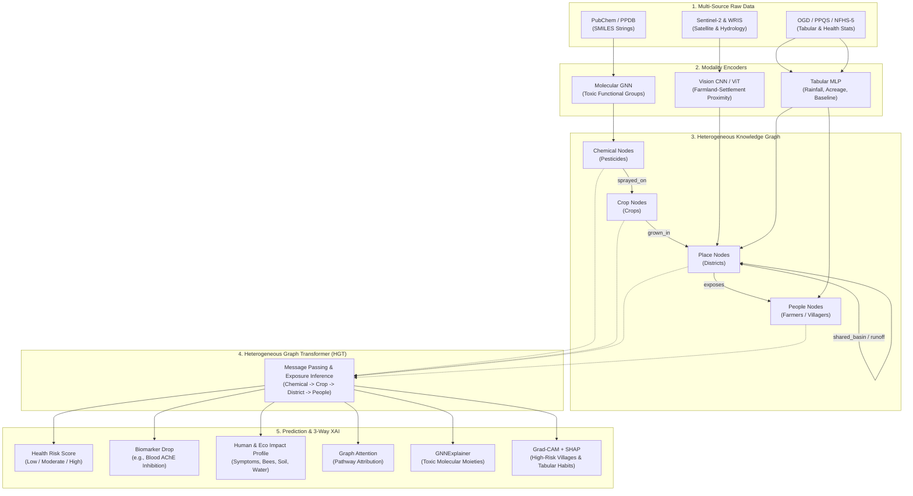
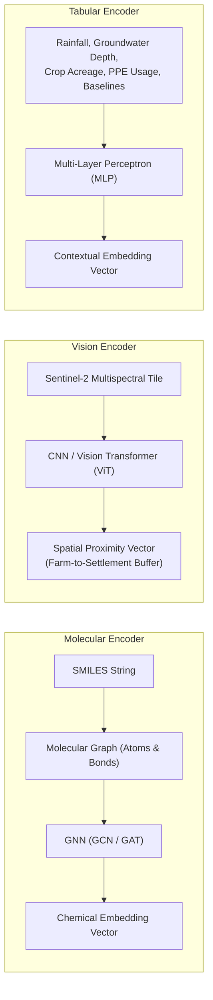
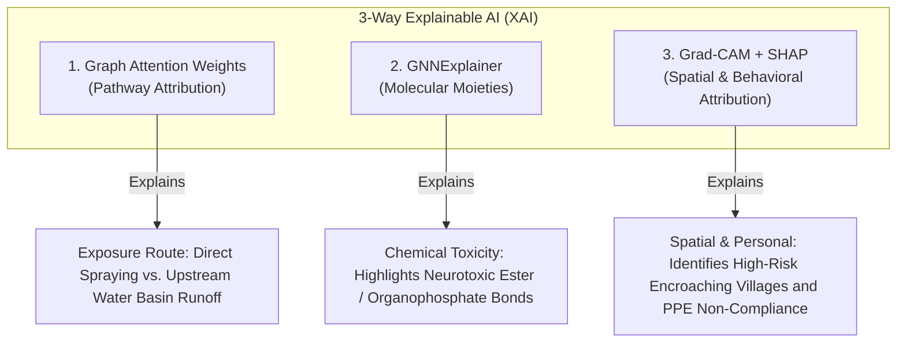

# Multimodal Knowledge Graph System for Pesticide Exposure & Health Risk Prediction

A multimodal, graph-driven framework combining satellite imagery, molecular graphs, tabular socio-hydrological data, and epidemiological datasets to predict, propagate, and explain pesticide exposure and health risks across India.

---

## 1. Exact Dataset List (7 Core Sources)

The system integrates seven curated datasets covering regulatory approvals, chemical structures, agricultural statistics, field residue tests, geospatial & hydrological context, and human health biomarkers.

| # | Dataset / Source | Access / Identifier | Data Modality & Key Features | Role in Pipeline |
|---|------------------|---------------------|------------------------------|------------------|
| **1** | **CIBRC Registered Pesticides** | [ppqs.gov.in](http://ppqs.gov.in) | Structured / Tabular: • Approved pesticide active ingredients • Permitted crop labels & approved formulations | Defines legal chemical-to-crop relationships and allowed crop spray targets. |
| **2** | **PPQS Statistical Database** | [ppqs.gov.in/statistical-database](http://ppqs.gov.in/statistical-database) | Tabular Time-Series: • State- & crop-wise chemical pesticide consumption (2021–22 to 2025–26) | Establishes regional chemical intensity and baseline application volume. |
| **3** | **PubChem + PPDB** (Pesticide Properties DataBase) | [PubChem API (`pubchempy`)](https://pubchem.ncbi.nlm.nih.gov/) + [PPDB](http://sitem.herts.ac.uk/aeru/ppdb/) | Molecular + Structured Profiling: • Molecular SMILES strings & 2D/3D chemical graphs • Human organ toxicity: neurotoxicity, hepatotoxicity, endocrine disruption • Eco-toxicity: LC50/EC50 for fish, honeybees, soil persistence ($DT_{50}$), water solubility | Feeds molecular graph encoders and supplies toxicity attribute ground truths. |
| **4** | **Open Government Data (OGD) India** | [data.gov.in](https://data.gov.in) / [aps.dac.gov.in](https://aps.dac.gov.in) | Tabular / Statistical: • District-wise crop cultivation area in hectares (Cotton, Rice, Wheat, Chilli, Vegetables) | Determines localized crop distribution and spatial crop load. |
| **5** | **PestiGlobal + MPRNL Reports** | [PestiGlobal (doi:10.6084/m9.figshare.30271873)](https://doi.org/10.6084/m9.figshare.30271873) + [MPRNL (ppqs.gov.in)](http://ppqs.gov.in) | Empirical Measurements: • Validated pesticide residues in Indian surface water, groundwater, soil, and food basket samples | Supplies ground-truth residue concentrations for calibration and validation. |
| **6** | **Google Earth Engine + India-WRIS + DataMeet** | Sentinel-2 / [indiawris.gov.in](https://indiawris.gov.in) / [DataMeet GitHub](https://github.com/datameet/maps) | Geospatial / Raster + Hydrological: • Sentinel-2 multispectral imagery (farmland-to-settlement proximity, water bodies) • District boundaries & river basin topographies • Annual/seasonal rainfall and groundwater depth | Maps spatial exposure pathways, buffer zones, and hydrological runoff across district boundaries. |
| **7** | **NFHS-5 + ICMR-NIN Telangana Dataset** | [dhsprogram.com](https://dhsprogram.com) / [data.gov.in](https://data.gov.in) / [ICMR-NIN (doi:10.17632/z526ncz8y3.4)](https://doi.org/10.17632/z526ncz8y3.4) | Epidemiological & Clinical Biomarkers: • District health indicators (anemia, respiratory illnesses, chronic conditions, drinking water source) • Real farm worker clinical tests: Acetylcholinesterase (AChE) blood nerve-enzyme levels, urinary pesticide metabolites | Forms the ground-truth targets for risk classification and biomarker drop regression. |

---

## 2. System Architecture & End-to-End Workflow

The framework operates in four coordinated steps: Knowledge Graph construction, Multimodal Feature Encoding, Heterogeneous Graph Transformer (HGT) message passing, and Prediction with 3-Way Explainable AI (XAI).

---

### Step 1: Knowledge Graph (KG) Construction

The graph topology maps the physical, chemical, and biological cascade of pesticide exposure:

1. **Node Definitions:**
   - **Chemical Nodes ($\mathcal{V}_{\text{chem}}$):** Unique active pesticide ingredients (e.g., Chlorpyrifos, Monocrotophos, Imidacloprid).
   - **Crop Nodes ($\mathcal{V}_{\text{crop}}$):** Agricultural commodity types (Cotton, Rice, Wheat, Chilli, Vegetables).
   - **Place Nodes ($\mathcal{V}_{\text{place}}$):** Spatial districts / administrative units with hydrological attributes.
   - **People Nodes ($\mathcal{V}_{\text{people}}$):** Exposed target cohorts (farmer groups, applicator demographics, village residents).

2. **Edge Topology & Exposure Flow:**
   $$\text{Chemical} \xrightarrow{\text{sprayed on}} \text{Crop} \xrightarrow{\text{grown in}} \text{Place} \xrightarrow{\text{exposes}} \text{People}$$

3. **Spatial & Hydrological Adjacency:**
   - **Hydrological / River Basin Edges:** $\text{Place}_i \xleftrightarrow{\text{shared basin}} \text{Place}_j$ links neighboring districts that share upstream/downstream river courses, drainage networks, or shallow aquifer basins.
   - Enables the propagation of runoff exposure signals even to downstream districts that have no direct local spraying records.

---

### Step 2: Multimodal Raw Data Encoders

Before graph propagation, raw multimodal inputs are projected into dense embedding vectors assigned to their corresponding nodes:

1. **Vision Encoder (CNN / ViT):**
   - **Input:** Sentinel-2 multispectral imagery of the district.
   - **Operation:** Evaluates settlement-to-cropland boundaries, water body overlaps, residential proximity to high-intensity agricultural parcels, and buffer zone violations.
   - **Output:** Dense spatial embedding representation for `Place` nodes.

2. **Molecular Encoder (GNN - Graph Convolutional / Graph Attention Network):**
   - **Input:** Chemical molecular structures represented as SMILES strings, converted to 2D/3D atom-bond graphs.
   - **Operation:** Learns structural motifs, organ toxicity moieties (e.g., organophosphate ester linkages, halogenated rings), lipophilicity, and persistence flags.
   - **Output:** Chemical embedding vector for `Chemical` nodes.

3. **Tabular Encoder (MLP / TabNet):**
   - **Input:** District rainfall statistics, groundwater table depth, crop acreage breakdown, reported personal protective equipment (PPE / mask) compliance, and demographic health baselines (NFHS-5).
   - **Output:** Normalized numerical latent embedding assigned to `Place` and `People` nodes.

---

### Step 3: Graph Neural Network (HGT) Message Passing

Because the graph involves distinct node types and relational edges, a **Heterogeneous Graph Transformer (HGT)** handles message passing across the network:

1. **Relation-Aware Signal Routing:**
   - Information flows across multi-hop paths:
     $$\text{Chemical} \longrightarrow \text{Crop} \longrightarrow \text{District} \longrightarrow \text{People}$$
   - Edge-type-specific attention weights compute how strongly chemical toxicity affects a crop, how intensively crop acreage shifts district load, and how residential proximity scales human intake.

2. **Handling Missing & Sparse Residue Data:**
   - When downstream districts lack direct water or soil residue lab samples, the GNN infers localized exposure risk using:
     - Cultivated crop distribution in the district
     - Approved and consumed pesticide volumes
     - Runoff transmitted via upstream hydrological neighbors ($\text{Place}_{\text{upstream}} \rightarrow \text{Place}_{\text{downstream}}$)

---

### Step 4: Multi-Task Prediction & Explainable AI (XAI)

#### A. Core Outputs
1. **Health Risk Score:** Categorical risk assessment (**Low**, **Moderate**, **High**) for the target population.
2. **Biomarker Impact Estimation:** Continuous regression prediction of clinical biomarkers, such as:
   - Serum / Erythrocyte Acetylcholinesterase (AChE) enzyme inhibition percentage.
   - Predicted urinary pesticide metabolite burden.
3. **Automated Human & Environmental Impact Report:**
   - **Human Acute & Chronic Conditions:** Neurobehavioral deficits, respiratory distress, endocrine disruption, dermatological syndromes.
   - **Ecosystem Degradation:** Honeybee toxicity hazard, aquatic bioaccumulation (fish mortality indices), groundwater persistence half-life ($DT_{50}$).

---

#### B. 3-Way Explainable AI (XAI) Framework

To ensure actionable clinical and regulatory utility, the predictions are substantiated through three complementary explanation methods:

| Explanation Module | Mechanism | Output / Clinical & Environmental Insight |
|--------------------|-----------|-------------------------------------------|
| **1. Graph Attention Attribution** | Attention coefficient analysis across heterogeneous edges | Pinpoints the primary risk pathway—whether danger originates from intense direct spraying, surface water runoff from upstream districts, or elevated crop acreage load. |
| **2. GNNExplainer** | Node & edge subgraph masking on molecular chemical graphs | Highlights the specific functional groups and sub-structures in the molecule (e.g., organophosphorus bonds) responsible for biological enzyme inhibition. |
| **3. Grad-CAM + SHAP** | Spatial heatmaps (Grad-CAM) + Feature attribution (SHAP) | • **Grad-CAM:** Overlays heatmaps on satellite tiles to isolate unbuffered farm-to-canal-to-village zones. • **SHAP:** Quantifies and ranks lifestyle/tabular factors (e.g., absence of PPE/masks, reliance on shallow open borewells). |

---

## 3. System Summary & Practical Application

- **Cross-Domain Synthesis:** Blends remote sensing, cheminformatics, public health records, and official agricultural data into one unified representation.
- **Resilience to Incomplete Data:** Overcomes ground-level data sparsity in rural monitoring via topological inference along hydrological basins.
- **Trustworthy Diagnostics:** Delivers regulatory-grade, multi-faceted explanations across spatial, molecular, and behavioral axes.

