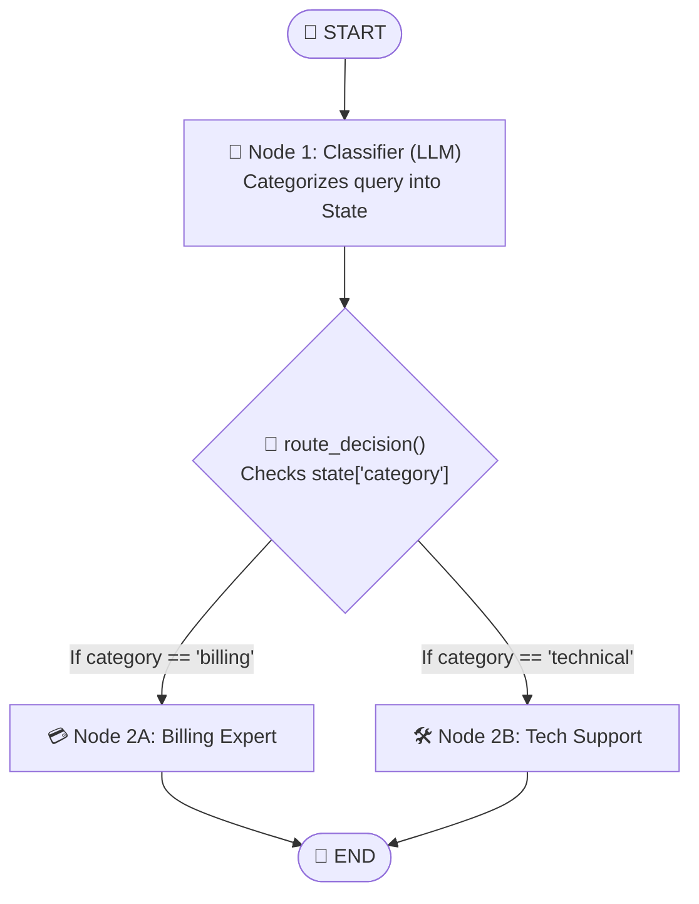

# Lesson 2: State & Conditional Routing (with LLM)

## 🎯 What is Conditional Routing?

In a standard graph, control flow is fixed:
$$\text{START} \longrightarrow \text{Node A} \longrightarrow \text{Node B} \longrightarrow \text{END}$$

In a **Conditional Graph**, the path branches based on the **State**:



---

## 🛠️ OpenRouter Setup (`openrouter/free`)

```python
import os
from dotenv import load_dotenv
from langchain_openai import ChatOpenAI

load_dotenv()
api_key = os.getenv("OPEN_API_KEY") or os.getenv("OPENROUTER_API_KEY")

llm = ChatOpenAI(
    base_url="https://openrouter.ai/api/v1",
    api_key=api_key,
    model="openrouter/free",
    temperature=0,
)
```

### 1. State Across the Decision
The state dictionary holds:
- **`query`**: What the user asked.
- **`category`**: What the classifier LLM decided (`billing` or `technical`).
- **`response`**: What the specialized department generated.

### 2. The Router Function (Traffic Cop)
A routing function is a standard Python function that:
- **Receives**: Current `state: dict`.
- **Does**: Checks state values (e.g., `if state["category"] == "billing"`).
- **Returns**: The string name of the next node (`"billing_node"` or `"tech_node"`).

```python
def route_decision(state: dict) -> str:
    if state["category"] == "billing":
        return "billing_node"
    return "tech_node"
```

---

## 💻 How `add_conditional_edges()` Works

```python
builder.add_conditional_edges(
    "classify",        # 1. Which node just finished?
    route_decision,    # 2. Which function decides the next step?
    {
        "billing_node": "billing_node",  # 3. Path Mapping (Return Value -> Target Node)
        "tech_node": "tech_node"
    }
)
```

---

## 🏃 Testing with Different Inputs

### Example 1 (Billing Path):
```python
user_input = {"query": "I got charged twice on my credit card!"}
# Flow: START -> classify -> billing_node -> END
```

### Example 2 (Technical Path):
```python
user_input = {"query": "My app crashes with error 500 when logging in."}
# Flow: START -> classify -> tech_node -> END
```
