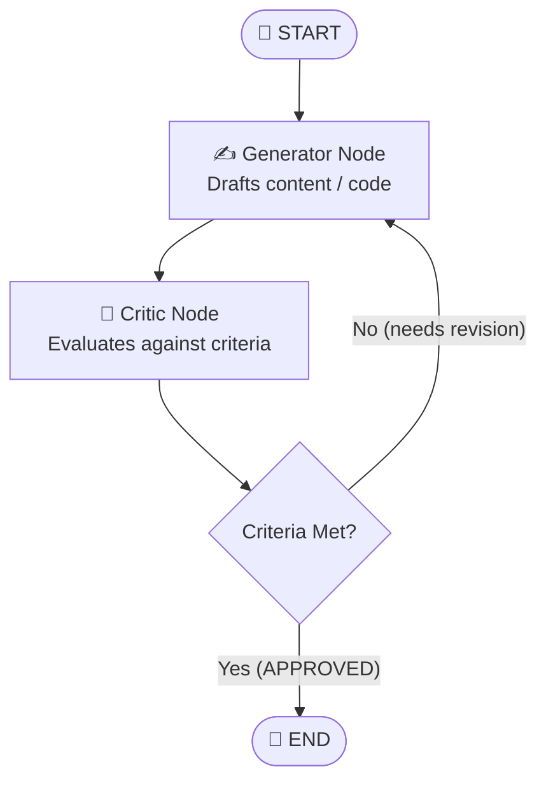
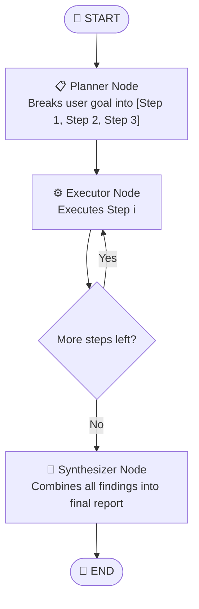

# Advanced LangGraph: Reflection, Planner-Executor, and Human-in-the-Loop

---

## 🧭 Lesson Overview & Mental Models

| Pattern | Mental Model | Real-World Analogy | Key Feature |
| :--- | :--- | :--- | :--- |
| **1. Reflection** | Generate ➔ Critique ➔ Refine | Student writes essay, Teacher reviews, Student revises | **Cyclic Feedback Loops** |
| **2. Planner-Executor** | Plan ➔ Execute Subtasks ➔ Synthesize | Project Manager breaks project into tasks, Engineers build each task | **Multi-step Decomposition** |
| **3. Human-in-the-Loop** | Pause ➔ Human Review ➔ Resume | Software requires Admin 2FA approval before pushing to production | **`interrupt_before` & `MemorySaver`** |

---

## 🔁 Pattern 1: Reflection ([04_reflection_pattern.py](file:///e:/python-DS1000/langgraph/04_reflection_pattern.py))

### Visual Architecture:

### Key Concept:
- Shows students how LangGraph supports **cyclic graphs** (loops), which standard chains cannot do.
- Safe termination condition (`revision_count >= 2`) prevents infinite loops.

---

## 📋 Pattern 2: Planner-Executor ([05_planner_executor.py](file:///e:/python-DS1000/langgraph/05_planner_executor.py))

### Visual Architecture:

### Key Concept:
- **Separation of Concerns**: Planning is decoupled from Execution.
- State carries a progress list `completed_steps` and `current_step_index`.

---

## 👤 Pattern 3: Human-in-the-Loop (HITL) ([06_human_in_the_loop.py](file:///e:/python-DS1000/langgraph/06_human_in_the_loop.py))

### Visual Architecture:

### Key Concepts:
1. **`MemorySaver()`**: Graph state is checkpointed in memory using a `thread_id`.
2. **`interrupt_before=["send_email"]`**: LangGraph pauses execution right before entering the designated node.
3. **Resuming Execution**: Running `app.invoke(None, config=config)` picks up right where it was paused.
