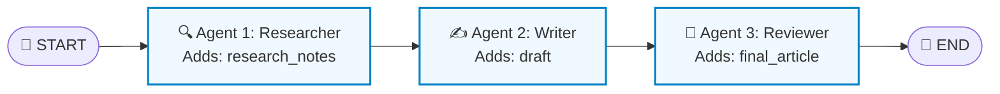

# Lesson 4: Multi-Agent Systems in LangGraph


---

## 🎯 What is a Multi-Agent System?

Instead of asking a single prompt to do everything (*"Research this, write an essay, format it, and check grammar"*), we divide the work among **specialized agents** with dedicated roles:

```
┌────────────────────────────────────────────────────────────────────────┐
│                        MULTI-AGENT COLLABORATION                       │
│                                                                        │
│   ┌────────────────┐      ┌─────────────┐      ┌───────────────────┐   │
│   │   RESEARCHER   │ ───> │   WRITER    │ ───> │     REVIEWER      │   │
│   │ (Gathers Facts)│      │  (Drafts)   │      │(Polishes & Audits)│   │
│   └────────────────┘      └─────────────┘      └───────────────────┘   │
└────────────────────────────────────────────────────────────────────────┘
```

---

## 💡 Why Multi-Agent Systems?

1. **Role Specialization**: LLMs perform much better when given a narrow persona and clear focus rather than a huge, cluttered prompt.
2. **Separation of Concerns**: If facts are wrong, we tune the *Researcher*. If style is dull, we tune the *Writer*. If grammar/tone is off, we tune the *Reviewer*.
3. **Shared State as the Baton**: Think of a relay race. The **State dictionary** is the baton passed from runner to runner.

---

## 📊 Visual Flowchart (Mermaid)



---

## 📋 State Progression at Each Handoff

| Step | Active Agent | Input Read From State | New Data Added To State |
| :--- | :--- | :--- | :--- |
| **0. Input** | User | — | `topic` |
| **1. Research** | **Researcher Agent** | `state["topic"]` | `state["research_notes"]` |
| **2. Drafting** | **Writer Agent** | `state["research_notes"]` | `state["draft"]` |
| **3. Reviewing** | **Reviewer Agent** | `state["draft"]` | `state["final_article"]` |

---

## 💻 Starter Code: [07_multi_agent_system.py]
```bash
# Run the Multi-Agent Pipeline
python 07_multi_agent_system.py
```

---

## 🎓 Classroom Discussion & Challenges

1. **Challenge 1 (Add a 4th Agent)**: Ask students to add a `Translator Agent` or `Social Media Formatter Agent` after the Reviewer.
2. **Challenge 2 (Conditional Feedback Loop)**: What if the Reviewer finds a major mistake? How could we use `add_conditional_edges` to route back to the Writer?
