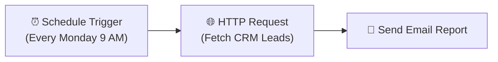

# Week 21: n8n Fundamentals - Complete Teaching Guide

---

## 🧭 1. What is n8n & Core Workflow Concepts

### What is n8n?
**n8n** (nodemation) is a powerful, node-based workflow automation tool. Think of it as:
- A visual version of Python scripts or backend API pipelines.
- An open-source, developer-friendly alternative to Zapier and Make.com.
- A platform that allows mixing visual drag-and-drop nodes with **raw JavaScript code and JSON data**.

### The 4 Core Workflow Concepts

```
┌────────────────────────────────────────────────────────────────────────┐
│                              n8n WORKFLOW                              │
│                                                                        │
│   ┌───────────────┐     ┌───────────────────┐     ┌────────────────┐   │
│   │    TRIGGER    │ ──> │ HTTP REQUEST / API│ ──> │ CODE / TRANSFORM│   │
│   │ (Webhook/Cron)│     │  (Fetch Data)     │     │ (Format/Filter)│   │
│   └───────────────┘     └───────────────────┘     └────────────────┘   │
└────────────────────────────────────────────────────────────────────────┘
```

1. **Nodes**: The building blocks. Each node performs an action (e.g., listening for a webhook, making an HTTP request, sending an email, executing JavaScript).
2. **Connections (Wires)**: Connect outputs of one node to inputs of the next node.
3. **Execution Data Structure (The golden rule of n8n)**:
   In n8n, data between nodes is **ALWAYS a list of JSON objects**:
   ```json
   [
     {
       "json": {
         "userId": 101,
         "name": "Alice",
         "email": "alice@example.com"
       }
     }
   ]
   ```
   > 💡 **Teaching Tip for Students**: If a node receives a list of 5 items, subsequent nodes will automatically run **5 times** (once for each item) unless aggregated!

4. **Active vs. Inactive Workflows**:
   - **Inactive**: Only runs manually when you click "Test step" or "Test workflow".
   - **Active (Toggle ON)**: Runs 24/7 in production listening for real triggers (like Webhooks or Crons).

---

## ⚡ 2. Triggers (Starting the Workflow)

A workflow cannot start on its own; it requires a **Trigger Node**.

### Common Trigger Types:

| Trigger Type | When it fires | Real-World Example |
| :--- | :--- | :--- |
| **Manual Trigger** | When clicking "Test workflow" | Debugging, testing during class |
| **Schedule / Cron Trigger** | At specific times / recurring intervals | Run daily at 9:00 AM to fetch sales reports |
| **Webhook Trigger** | When an external service sends an HTTP request | Stripe payment received, GitHub push |
| **App-Specific Triggers** | On events inside 3rd-party services | New row in Google Sheets, new message in Slack |



---

## 🪝 3. Webhooks (Receiving Incoming Data)

A **Webhook** is an HTTP endpoint created by n8n that waits for other systems to send data to it (*"Don't call us, we'll call you"*).

### Webhook Node Setup in n8n:
1. **HTTP Method**: `GET`, `POST`, `PUT`, `DELETE` (usually `POST`).
2. **Path**: Custom endpoint slug (e.g., `user-signup` or `lead-form`).
3. **Response Mode**:
   - `On Received`: Immediately sends `200 OK` back to the sender.
   - `Using 'Respond to Webhook' Node`: Allows your workflow to process data and send a custom reply back to the caller!

### ⚠️ The Critical Difference: Test URL vs. Production URL

```
┌───────────────────────────────────────────────────────────────────┐
│                      WEBHOOK URL MODES IN n8n                     │
│                                                                   │
│  🧪 TEST URL:                                                     │
│     http://localhost:5678/webhook-test/my-hook                    │
│     • Active ONLY when you click "Listen for test event"          │
│     • Listens for exactly ONE request, then stops                 │
│     • Used for building and debugging in class                    │
│                                                                   │
│  🚀 PRODUCTION URL:                                               │
│     http://localhost:5678/webhook/my-hook                         │
│     • Active ONLY when workflow is toggled ACTIVE (ON)            │
│     • Handles real-world 24/7 traffic in the background           │
└───────────────────────────────────────────────────────────────────┘
```

---

## 🌐 4. HTTP Request Node (Calling External APIs)

The **HTTP Request** node is n8n's built-in `curl` or Python `requests.get() / requests.post()`.

### Key Parameters:
- **Method**: `GET`, `POST`, `PUT`, `PATCH`, `DELETE`.
- **URL**: The API endpoint (e.g., `https://api.github.com/users/octocat`).
- **Authentication**:
  - `None` (Public APIs)
  - `Header Auth` (e.g., `Authorization: Bearer <TOKEN>`)
  - `Generic Credential Type` (API Key, OAuth2, Basic Auth)
- **Send Query Parameters**: Key-value pairs attached to URL (`?limit=10&page=1`).
- **Send Body**: JSON payload sent in POST/PUT requests:
  ```json
  {
    "customer": "{{ $json.name }}",
    "amount": {{ $json.price }}
  }
  ```

---

## 📦 5. Variables in n8n

n8n offers multiple levels of variables:

### 1. In-Flight Data (`$json`)
Refers to the incoming item currently being processed by the node:
- `$json.name` $\to$ Value of `"name"` from the current item.
- `$json.address.city` $\to$ Nested value.

### 2. Referencing Other Nodes (`$('NodeName').item.json`)
You can access data produced by **any previous node in the workflow**, not just the immediate parent:
- `$('Webhook').item.json.body.email`
- `$('Fetch User').first().json.id`

### 3. Environment Variables (`$env`)
Used for secrets, API keys, and environment settings:
- `{{ $env.OPENAI_API_KEY }}`
- `{{ $env.PORT }}`

---

## 🔤 6. Expressions in n8n

Whenever you want dynamic values in node parameters, you switch from **Fixed** to **Expression**.
Expressions in n8n are wrapped in **double curly braces `{{ ... }}`** and evaluated as JavaScript.

### Expression Cheat Sheet:

| What you want to do | Expression Syntax | Example Result |
| :--- | :--- | :--- |
| **Read field value** | `{{ $json.username }}` | `"john_doe"` |
| **String concatenation** | `{{ "Hello, " + $json.name + "!" }}` | `"Hello, Alice!"` |
| **String method** | `{{ $json.email.toLowerCase().trim() }}` | `"clean@mail.com"` |
| **Current timestamp** | `{{ $now.format('YYYY-MM-DD') }}` | `"2026-10-15"` |
| **Ternary logic (if/else)**| `{{ $json.score >= 50 ? 'Pass' : 'Fail' }}` | `"Pass"` |
| **Number calculation** | `{{ $json.price * 1.18 }}` | `118` (with 18% tax) |
| **Access previous node**| `{{ $('Webhook').item.json.headers.host }}` | `"localhost:5678"` |

---

## 🛠️ Complete Hands-on Classroom Lab

In this repository, we have created two companion files:
1. **[n8n_fundamentals_workflow.json](file:///e:/python-DS1000/langgraph/n8n_fundamentals_workflow.json)**:
   - A complete, copy-pasteable n8n workflow containing a **Webhook Trigger**, an **HTTP Request node**, a **Code node (using expressions & variables)**, and a **Respond to Webhook node**.
   - Students can import this directly into n8n via **Workflow $\to$ Import from File / Clipboard**.
2. **[test_n8n_webhook.py](file:///e:/python-DS1000/langgraph/test_n8n_webhook.py)**:
   - A simple Python script to simulate sending webhook requests with headers and payloads to test n8n triggers.
