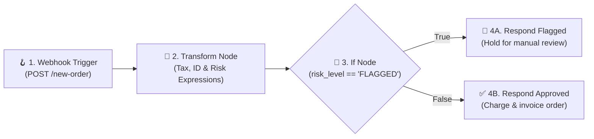
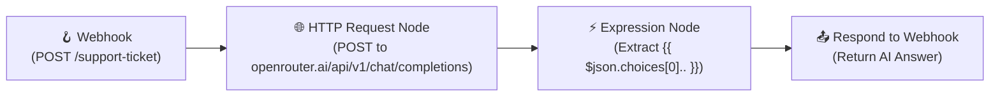
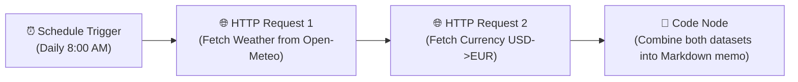

# Advanced n8n Industry Examples & Curriculum

---

## 🧭 Overview of the 3 Industry Examples

These examples move beyond theory and demonstrate how real software companies use n8n for production workflows:

| Example | Business Use-Case | Key Skills Demonstrated |
| :--- | :--- | :--- |
| **Example 1: E-Commerce Fraud & Order Pipeline** | Instant order intake, tax calculation, and risk scoring | Webhooks, POST Payloads, Math Expressions, Ternary Logic, If Branching, Dynamic Webhook Response |
| **Example 2: AI Support Ticket Classifier** | Calling an LLM API via pure HTTP Node | HTTP Request Node (POST, Headers, Bearer Auth, JSON Payload), AI Prompt Injection via Expressions |
| **Example 3: Automated Daily Operations Digest** | Morning cron job fetching weather & currency data | Schedule / Cron Trigger, API Chaining, Date Formatting (`$now`), Nested JSON parsing |

---

## 🛒 Example 1: E-Commerce Order & Fraud Detection Pipeline

### 📊 Visual Workflow Architecture


### 1. The Scenario
When a user buys something on a storefront, the checkout system sends a Webhook to n8n.
n8n needs to:
1. Calculate the final price with 18% GST/VAT.
2. Generate an Order ID formatted with today's date: `ORD-20261019-XXXX`.
3. Detect potential fraud (e.g. order value > $3,000 OR billing country does not match shipping country).
4. If flagged $\to$ return a `403 Review Needed` response.
5. If safe $\to$ return a `200 Approved` response with complete order details.

---

### 2. Key Expressions Used in This Workflow

| Requirement | Expression Syntax |
| :--- | :--- |
| **Extract order amount** | `{{ Number($json.body.amount || 0) }}` |
| **Calculate 18% Tax** | `{{ Number(($json.body.amount * 0.18).toFixed(2)) }}` |
| **Calculate Total** | `{{ Number(($json.body.amount * 1.18).toFixed(2)) }}` |
| **Date-based Order ID** | `{{ 'ORD-' + $now.format('yyyyMMdd') + '-' + Math.floor(1000 + Math.random() * 9000) }}` |
| **Fraud Detection Rule** | `{{ ($json.body.amount > 3000 || $json.body.billing_country !== $json.body.shipping_country) ? 'FLAGGED' : 'CLEARED' }}` |

---

### 3. How to Demo This in Class

1. Import **[n8n_ecommerce_fraud_workflow.json](file:///e:/python-DS1000/langgraph/n8n_ecommerce_fraud_workflow.json)** into n8n.
2. Open the **Order Webhook** node and click **Listen for test event**.
3. Run the test script:
   ```bash
   # Test normal clean order:
   python test_n8n_ecommerce.py clean

   # Test high-risk fraud order (mismatched country & high amount):
   python test_n8n_ecommerce.py fraud
   ```
4. Show students how the **If node** inspects the expression result and routes the execution into different branches in real-time!

---

## 🤖 Example 2: Calling AI Models via Pure HTTP Request Node

> **Teaching Goal:** Show students that they do NOT need specialized pre-built nodes to use AI. Any LLM (OpenRouter, OpenAI, Anthropic, Groq) can be called using the universal **HTTP Request** node!

### 📊 Visual Workflow Architecture


### Node Configuration Settings:
- **Node**: `HTTP Request`
- **Method**: `POST`
- **URL**: `https://openrouter.ai/api/v1/chat/completions`
- **Authentication**: `Header Auth`
  - Name: `Authorization`
  - Value: `Bearer {{ $env.OPEN_API_KEY }}`
- **Send Body**: `JSON`
  ```json
  {
    "model": "openrouter/free",
    "messages": [
      {
        "role": "system",
        "content": "You are a polite Tier-1 tech support specialist. Categorize the issue as 'Billing', 'Bug', or 'General', then provide a 2-sentence resolution."
      },
      {
        "role": "user",
        "content": "={{ $('Webhook').item.json.body.ticket_text }}"
      }
    ]
  }
  ```

### Parsing the AI Response with Expressions:
- **Raw AI response text**:  
  `{{ $json.choices[0].message.content }}`
- **Token usage count**:  
  `{{ $json.usage.total_tokens }}`

---

## ⏰ Example 3: Automated Daily Operations & Weather Digest

> **Teaching Goal:** Show how to schedule recurring background tasks and combine data from two different public APIs using in-memory variables.

### 📊 Visual Workflow Architecture


### The Recipe:
1. **Schedule Trigger**:
   - Trigger Interval: `Days` $\to$ Time: `08:00`.
2. **HTTP Request 1 (Public Weather - No API key needed!)**:
   - URL: `https://api.open-meteo.com/v1/forecast?latitude=28.61&longitude=77.20&current=temperature_2m,precipitation`
3. **HTTP Request 2 (Currency Exchange - Free public API)**:
   - URL: `https://api.exchangerate-api.com/v4/latest/USD`
4. **Code Node (Combining variables across nodes)**:
   ```javascript
   const weather = $('HTTP Request 1').item.json.current;
   const rates = $('HTTP Request 2').item.json.rates;

   const tempC = weather.temperature_2m;
   const rain = weather.precipitation;
   const eurRate = rates.EUR;

   const rainStatus = rain > 0 ? "🌧️ Wet weather expected: indoor dispatch" : "☀️ Clear weather: normal dispatch";

   return {
     report_date: $now.format('YYYY-MM-DD'),
     temperature_celsius: tempC,
     weather_advisory: rainStatus,
     usd_to_eur: eurRate,
     summary: `Daily Ops Briefing (${$now.format('DD MMM YYYY')}): Current Temp: ${tempC}°C. ${rainStatus}. Exchange Rate: 1 USD = ${eurRate} EUR.`
   };
   ```

---

## 🎓 Summary of Advanced Expression Tricks for Students

```javascript
// 1. Safe Navigation (avoid crash if field is missing)
{{ $json.body?.customer?.email || 'no-email@provided.com' }}

// 2. Format Currency with Commas
{{ '$' + Number($json.amount).toLocaleString('en-US') }}

// 3. Array Filtering / Counting
{{ $json.items.filter(item => item.price > 50).length }}

// 4. Date Math (Add 3 days to current date)
{{ $now.plus({ days: 3 }).format('YYYY-MM-DD') }}

// 5. String Manipulation
{{ $json.full_name.split(' ')[0] }} // First name only
```
