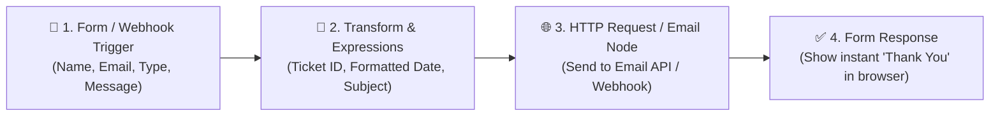

# Lesson: Form-to-Email Automation in n8n

---

## 🎯 Why This is the Perfect Teaching Project

This single project naturally incorporates **every single topic** from the syllabus:
1. **Workflow Concepts:** Linear pipeline passing clean JSON items from step to step.
2. **Triggers:** Interactive **Form Trigger** (or Webhook Trigger) that fires instantly on submission.
3. **Webhooks:** Receiving form field payloads over HTTP POST.
4. **HTTP Requests:** Sending the formatted email payload to an email service or notification webhook.
5. **Variables:** Accessing in-flight data (`$json.name`, `$json.email`).
6. **Expressions:** Dynamic subject line, date stamps (`$now`), and conditional badges.

---

## 📊 Visual Workflow Architecture



---

## 🔍 Step-by-Step Node Breakdown (What to Teach in Class)

### Node 1: The Form Trigger (`n8n-nodes-base.formTrigger`)
> **💡 Why Students Love This:** n8n has a built-in **Form Trigger** that automatically generates an interactive HTML web page with zero coding! Students can open the generated URL in Chrome, fill in the fields, and click **Submit**.

**Fields configured in the Form:**
- **Full Name** (Text field)
- **Email Address** (Email field)
- **Inquiry Type** (Dropdown: `General Question`, `Support / Bug`, `Sales Request`)
- **Message** (Long Text field)

---

### Node 2: Transform (Variables & Expressions)
This is where the core lesson happens. Show students how we use **Expressions** to clean, format, and enhance the raw form data before sending the email.

```javascript
// Expressions demonstrated inside this node:

// 1. Dynamic Ticket ID (Luxon tokens: yyyy for year, MM for month, dd for day)
ticket_id: {{ 'TICK-' + $now.format('yyyyMMdd') + '-' + Math.floor(1000 + Math.random() * 9000) }}

// 2. Clean Email (String method)
clean_email: {{ $json.email.toLowerCase().trim() }}

// 3. Conditional Subject Line (Ternary operator)
email_subject: {{ ($json.inquiry_type === 'Support / Bug' ? '🚨 [URGENT SUPPORT] ' : '📩 [NEW INQUIRY] ') + $json.name }}

// 4. Formatted Timestamp
submitted_date: {{ $now.format('dd MMMM yyyy, hh:mm a') }}

// 5. HTML Email Body (Template interpolation)
html_body: `
  <h2>New Contact Form Submission</h2>
  <p><strong>Ticket ID:</strong> ${ticket_id}</p>
  <p><strong>From:</strong> ${$json.name} (${clean_email})</p>
  <p><strong>Category:</strong> ${$json.inquiry_type}</p>
  <p><strong>Date:</strong> ${submitted_date}</p>
  <hr />
  <p><strong>Message:</strong></p>
  <blockquote>${$json.message}</blockquote>
`
```

---

### Node 3: Sending the Email (HTTP Request vs. Gmail / SMTP)

> **⚠️ Classroom Pro-Tip:** Setting up personal Gmail / SMTP credentials in class often wastes 20–30 minutes because of 2FA, App Passwords, and security blocks.
>
> **Best Practice in Class:**
> 1. **Option A (Universal & Zero Setup):** Use the **HTTP Request** node calling an email API (like Resend / Mailgun) or a free notification webhook (like Webhook.site / Discord / Slack). It works 100% of the time with zero credential errors!
> 2. **Option B (Real Gmail Node):** Show the **Gmail / Send Email** node once the workflow logic is understood.

**HTTP Request Settings (Option A):**
- **Method:** `POST`
- **URL:** `https://webhook.site/` or your internal email endpoint
- **Send Body:**
  ```json
  {
    "to": "support@company.com",
    "reply_to": "={{ $json.clean_email }}",
    "subject": "={{ $json.email_subject }}",
    "html": "={{ $json.html_body }}"
  }
  ```

---

### Node 4: User Confirmation (On-Screen Form Response)
- When the visitor submits the form, n8n shows a friendly confirmation message right on their browser screen:
  ```text
  Thank you, {{ $json.name }}! 
  Your inquiry has been received (Ticket #{{ $json.ticket_id }}). 
  Our team will reply to {{ $json.clean_email }} within 24 hours.
  ```

---

## 🚀 How to Run the Classroom Demo

1. **Import the Workflow:**
   - In n8n, click `...` (top right) $\to$ **Import from File** $\to$ select [n8n_form_to_email_workflow.json](file:///e:/python-DS1000/langgraph/n8n_form_to_email_workflow.json).
2. **Open the Form URL:**
   - Open the **Form Trigger** node.
   - Copy the **Test URL** (or Production URL when active).
   - Paste it in your web browser $\to$ Show students the clean web form!
3. **Submit the Form:**
   - Enter:
     - Name: `Jane Doe`
     - Email: `JANE.DOE@Example.COM` (intentionally uppercase to show `.toLowerCase()`)
     - Type: `Support / Bug` (to show the `🚨 [URGENT SUPPORT]` prefix)
     - Message: `Our payment gateway is returning error 502.`
   - Click **Submit**.
4. **Inspect the Workflow Canvas:**
   - Watch the workflow light up green.
   - Show students how `$json` held the form inputs, expressions transformed the data, and the formatted email payload was delivered.

---

## 💻 Alternative: Standalone HTML Form ([sample_form.html](file:///e:/python-DS1000/langgraph/sample_form.html))
If you prefer teaching standard website integration:
- Open [sample_form.html](file:///e:/python-DS1000/langgraph/sample_form.html) in your browser.
- It posts directly to the n8n Webhook endpoint via JavaScript `fetch()`.
