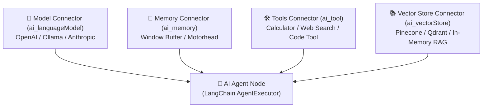
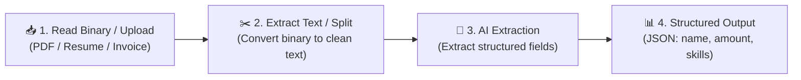

# Week 22: AI Automation in n8n - Master Lecture & Lab Guide

---

## 🧭 Overview of Week 22 Topics

| Topic | Core Technology | What Students Learn |
| :--- | :--- | :--- |
| **1. OpenAI Integration** | Cloud LLMs (`gpt-4o-mini`, OpenRouter) | Setting up cloud API keys, model parameters, temperature, prompt engineering in n8n. |
| **2. Ollama Integration** | Local LLMs (`llama3.2`, `mistral`, `phi-3`) | Running 100% free, private local models on `http://localhost:11434` with zero API fees. |
| **3. LangChain + n8n** | LangChain Core Sub-nodes | How n8n's Advanced AI connects Models, Agents, Memories, Tools, and Vector Stores. |
| **4. Document Processing** | Binary loaders, text splitters, RAG | Ingesting PDFs, invoices, and resumes, chunking content, and querying document data. |
| **5. Email Automation** | AI-driven email classification & drafting | Automatically categorizing incoming emails, parsing attachments, and drafting smart replies. |

---

## ☁️ 1. OpenAI Integration in n8n

### How It Works:
In n8n, OpenAI can be used in two ways:
1. **As a Chat Model sub-node (`@n8n/n8n-nodes-langchain.lmChatOpenAi`):** Attached directly to an AI Agent or LLM Chain.
2. **As a standalone OpenAI Action node (`n8n-nodes-base.openAi`):** For direct one-off summarization, text completion, or image generation.

### Key Parameters to Teach:
- **Model:** `gpt-4o-mini` (fast, cost-effective) or `gpt-4o` (complex reasoning).
- **Temperature:**
  - `0.0 - 0.2`: Strict, factual tasks (data extraction, JSON formatting, math).
  - `0.7 - 1.0`: Creative tasks (marketing copy, brainstorming, conversational tone).
- **Using OpenRouter / Custom Endpoints:**
  - In the OpenAI Chat Model node $\to$ **Options** $\to$ **Base URL:** `https://openrouter.ai/api/v1`.
  - This allows students to use free models (`openrouter/free`) with the exact same OpenAI node!

---

## 🦙 2. Ollama Integration (Local & Private AI)

> **💡 Why Students Love Ollama:** No API keys, no credit card, no billing limits, and 100% offline data privacy!

### Architecture Comparison:

```
┌────────────────────────────────────────────────────────────────────────┐
│                        CLOUD LLM vs LOCAL OLLAMA                       │
│                                                                        │
│  ☁️ Cloud (OpenAI / OpenRouter):                                       │
│     n8n Node ────[ Internet ]────> api.openai.com ($/token)            │
│                                                                        │
│  🦙 Local (Ollama):                                                    │
│     n8n Node ────[ localhost:11434 ]────> Local GPU / RAM ($0 Free!)   │
└────────────────────────────────────────────────────────────────────────┘
```

### Setup Steps for Students:
1. **Install Ollama:** Download from `https://ollama.com`.
2. **Pull a Model in Terminal:**
   ```bash
   ollama run llama3.2
   # or for lightweight machines:
   ollama run phi3:mini
   ```
3. **In n8n:**
   - Add the **Ollama Chat Model** node (`@n8n/n8n-nodes-langchain.lmChatOllama`).
   - Base URL: `http://localhost:11434` *(If running n8n in Docker on Windows/Mac, use `http://host.docker.internal:11434`)*.
   - Model: `llama3.2` or `phi3:mini`.

---

## 🦜🔗 3. LangChain + n8n Architecture

n8n did not reinvent the wheel for AI. Its **Advanced AI** suite is a visual implementation of the open-source **LangChain framework**.

### The 5 Sub-Node Connectors of LangChain in n8n:



| LangChain Concept | n8n Node Equivalent | Purpose |
| :--- | :--- | :--- |
| **Agent / Executor** | `AI Agent` (`@n8n/...agent`) | The coordinator that plans steps and decides which tools to call. |
| **Language Model** | `OpenAI Chat Model`, `Ollama Chat Model` | The reasoning engine powering the agent. |
| **Memory** | `Window Buffer Memory` | Remembers the last $N$ messages for multi-turn chats. |
| **Tools** | `Calculator`, `Serper/Google Search`, `Custom Tool` | External functions the agent can execute autonomously. |
| **Retrieval (RAG)** | `Vector Store`, `Embeddings`, `Text Splitter` | Ingests private company knowledge for contextual answers. |

---

## 📄 4. Document Processing (PDFs, Resumes, Invoices)

Document processing in AI workflows requires handling **binary data** and converting it into chunks of text.

### The Document Ingestion Pipeline:


### Key Techniques to Teach:
1. **Handling Binary Files in n8n:**
   - In n8n, files are held in the special `$binary` object (e.g., `$binary.data`).
2. **Text Extraction:**
   - Using the **Extract from File** node to turn PDFs or Word documents into plain strings.
3. **Chunking / Splitting:**
   - Why do we chunk? Large 50-page documents exceed model token limits. The **Recursive Character Text Splitter** breaks documents into 1,000-character segments with 100-character overlap to retain context.

---

## 📬 5. End-to-End AI Email Automation Pipeline

This capstone project combines all 5 topics into one automated workflow:

### Scenario:
A client sends an email inquiry with an attached PDF invoice/brief. The AI system:
1. **Triggers** on the incoming email / message.
2. **Extracts & Analyzes** the attached document text.
3. **Classifies** the urgency and sentiment using the LLM (OpenAI or Ollama).
4. **Drafts a personalized, context-aware reply**.
5. **Dispatches the email** or requests human approval.

---

## 💻 Included Files in Workspace

1. **[n8n_ai_document_email_workflow.json](file:///e:/python-DS1000/langgraph/n8n_ai_document_email_workflow.json)**:
   - Ready-to-import n8n workflow demonstrating OpenAI/Ollama Chat Model, Document Parsing, AI Classification, and Email Response formatting.
2. **[sample_invoice.txt](file:///e:/python-DS1000/langgraph/sample_invoice.txt)**:
   - A mock invoice document to test the document extraction node.
3. **[test_email_automation.py](file:///e:/python-DS1000/langgraph/test_email_automation.py)**:
   - A Python test script to simulate an incoming email with document payload.
