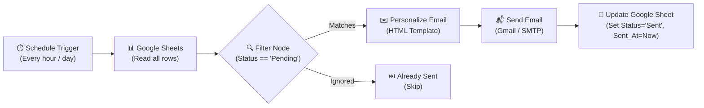

# Master Guide: Google Sheets to Email Automation in n8n

---

## 🎯 What You Are Building

An automated, enterprise-grade pipeline that monitors a Google Sheet (such as new event registrations, customer leads, or pending invoice notices), extracts the records, personalizes a formatted email for each recipient, sends the email, and **updates the sheet to mark the row as "Sent"**.



---

## 📋 Recommended Google Sheet Structure

Before building the workflow, create a Google Sheet with these headers in Row 1:

| A (`row_id`) | B (`full_name`) | C (`email`) | D (`course_name`) | E (`registration_date`) | F (`status`) | G (`sent_at`) |
| :--- | :--- | :--- | :--- | :--- | :--- | :--- |
| `2` | Alexander Pierce | `alex@example.com` | Full-Stack AI Automation | 2026-10-24 | **Pending** | *(blank)* |
| `3` | Elena Rostova | `elena@example.com` | LangGraph Multi-Agents | 2026-10-24 | **Pending** | *(blank)* |
| `4` | Marcus Vance | `marcus@example.com` | n8n Enterprise Ops | 2026-10-20 | **Sent** | 2026-10-20 14:10:00 |

> [!IMPORTANT]
> **The Golden Rule of Spreadsheet Automation (Deduplication):**
> If you do not update the row status to **"Sent"** after dispatching the email, the workflow will re-send emails to the exact same people every single time the schedule runs!

---

## 🛠️ Step-by-Step Canvas Guide

### Step 1: Trigger Node
1. **Manual Trigger** (for testing): Add a **Manual Trigger** node.
2. **Schedule Trigger** (for production): Add a **Schedule Trigger** set to run every 1 hour (or every day at 09:00).

---

### Step 2: Read Google Sheets (or Mock Data for Instant Testing)

#### For Live Production (Google Sheets Node):
1. Add the **Google Sheets** node (`n8n-nodes-base.googleSheets`).
2. **Operation**: `Get Row(s)`.
3. **Document**: Select from list or enter your Spreadsheet ID / URL.
4. **Sheet**: `Sheet1`.
5. **Output**: Returns each row as an individual JSON item in n8n.

#### For Instant Testing (No Google Credentials Required):
If you haven't configured Google Cloud OAuth credentials yet, use a **Code Node** with mock data:
```javascript
return [
  {
    json: {
      row_id: 2,
      full_name: "Alexander Pierce",
      email: "alex.pierce@example.com",
      course_name: "Full-Stack AI Automation",
      registration_date: "2026-10-24",
      status: "Pending"
    }
  },
  {
    json: {
      row_id: 3,
      full_name: "Elena Rostova",
      email: "elena.rostova@example.com",
      course_name: "LangGraph Multi-Agents",
      registration_date: "2026-10-24",
      status: "Pending"
    }
  },
  {
    json: {
      row_id: 4,
      full_name: "Marcus Vance",
      email: "marcus.vance@example.com",
      course_name: "n8n Enterprise Ops",
      registration_date: "2026-10-20",
      status: "Sent"
    }
  }
];
```

---

### Step 3: Filter Node (Deduplication)
1. Add the **Filter** node (`n8n-nodes-base.filter`).
2. Set the condition:
   - **Value 1**: `={{ $json.status }}`
   - **Operator**: `equals (string)` (ignore case)
   - **Value 2**: `Pending`
3. Click **Test Step**.
   - Notice: Row 4 (`Marcus Vance`, status = `Sent`) is filtered out! Only rows with status `Pending` proceed.

---

### Step 4: Personalize Email Template (Edit Fields Node)
1. Add an **Edit Fields (Set)** node (`n8n-nodes-base.set`).
2. Name it: `Draft Personalized Email Template`.
3. Add the following fields:
   - **`recipient_email`** (String):
     ```javascript
     ={{ $json.email }}
     ```
   - **`email_subject`** (String):
     ```javascript
     =Welcome to {{ $json.course_name }}, {{ $json.full_name }}!
     ```
   - **`email_html`** (String):
     ```html
     <div style="font-family: Arial, sans-serif; line-height: 1.6; color: #333; max-width: 600px; margin: 0 auto; border: 1px solid #e5e7eb; border-radius: 8px; padding: 24px;">
       <h2 style="color: #4338ca; margin-top: 0;">Welcome to {{ $json.course_name }}!</h2>
       <p>Hi <strong>{{ $json.full_name }}</strong>,</p>
       <p>We received your registration on <strong>{{ $json.registration_date }}</strong>. We are thrilled to welcome you to the cohort!</p>
       
       <div style="background: #f8fafc; border-left: 4px solid #4338ca; padding: 16px; margin: 20px 0;">
         <p style="margin: 0; font-size: 14px; color: #475569;">
           <strong>Next Steps:</strong> Check your inbox tomorrow for onboarding portal credentials and community Discord invites.
         </p>
       </div>

       <p>If you have any questions, simply reply directly to this email.</p>
       <p style="margin-top: 30px;">Best regards,<br><strong>Automation Academy Team</strong></p>
     </div>
     ```

---

### Step 5: Send Email (Gmail or Test Webhook)

#### Option A: Using the Gmail Node
1. Add the **Gmail** node (`n8n-nodes-base.gmail`).
2. **Resource**: `Message`.
3. **Operation**: `Send`.
4. **To**: `={{ $json.recipient_email }}`.
5. **Subject**: `={{ $json.email_subject }}`.
6. **Email Type**: Select `HTML`.
7. **Message**: `={{ $json.email_html }}`.

#### Option B: Test Dispatch without Email Credentials (HTTP Request)
1. Add an **HTTP Request** node (`n8n-nodes-base.httpRequest`).
2. **Method**: `POST`.
3. **URL**: `https://jsonplaceholder.typicode.com/posts`.
4. **Body Content Type**: `JSON`.
5. **JSON**:
   ```javascript
   ={
     "to": "{{ $json.recipient_email }}",
     "subject": "{{ $json.email_subject }}",
     "html": {{ JSON.stringify($json.email_html) }},
     "dispatched_at": "{{ $now.format('yyyy-MM-dd HH:mm:ss') }}"
   }
   ```

---

### Step 6: Close the Loop (Update Google Sheet Row)
1. Add the **Google Sheets** node.
2. **Operation**: `Update Row(s)`.
3. **Data Mode**: `Map Each Column Below`.
4. **Row ID / Key**:
   - Column to Match On: `email` (or `row_id`).
   - Match Value: `={{ $('Filter: Only \'Pending\' Status').item.json.email }}`.
5. **Fields to Update**:
   - `status`: `Sent`
   - `sent_at`: `={{ $now.format('yyyy-MM-dd HH:mm:ss') }}`
6. Save and test!

---

## 🔐 Google Cloud OAuth Setup (For Teachers & Students)

If students encounter permission errors when creating Google Sheets / Gmail credentials:

1. Go to [Google Cloud Console](https://console.cloud.google.com).
2. Create a project $\to$ Enable **Google Sheets API** and **Gmail API**.
3. Under **OAuth consent screen**:
   - User Type: `External`.
   - Add Test Users: Add the Gmail addresses that will use the automation.
4. Under **Credentials** $\to$ **Create Credentials** $\to$ **OAuth 2.0 Client ID**:
   - Application Type: `Web application`.
   - Authorized Redirect URIs:
     ```text
     http://localhost:5678/rest/oauth2-credential/callback
     ```
5. Copy the **Client ID** and **Client Secret** into n8n's credential settings.

---

## ⚡ Included Files in Your Workspace

- 📦 **Pre-built Workflow JSON:** [n8n_google_sheets_to_email_workflow.json](file:///e:/python-DS1000/langgraph/n8n_google_sheets_to_email_workflow.json)
  *(Import into n8n via "Import from File" to immediately see and test all connected nodes!)*
