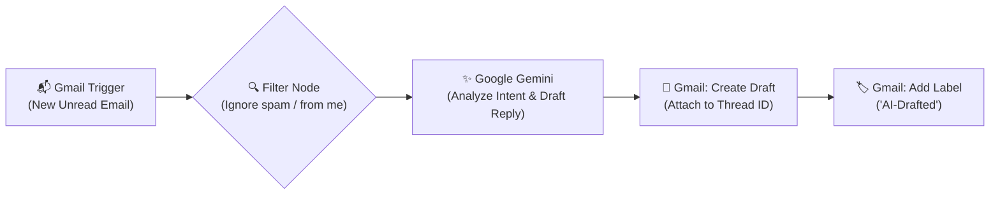

# Master Guide: Autonomous Gmail AI Assistant (Smart Draft Copilot)

---

## 🎯 What You Are Building

An autonomous AI Copilot that monitors your Gmail inbox for new unread messages, uses **Google Gemini** to analyze the sender's inquiry, and **creates a ready-to-review draft directly inside the email conversation thread**.



> [!TIP]
> **Why Create a Draft instead of Auto-Sending? (Human-in-the-Loop)**
> Auto-sending can accidentally send hallucinations or miss private context. Creating a **Draft** in the existing thread lets you open Gmail on your phone or computer, review the AI's response in 2 seconds, edit if needed, and hit **Send**.

---

## 🏗️ Step-by-Step Canvas Guide

### Step 1: The Inbound Email Trigger

1. In n8n, add the **Gmail Trigger** node (`n8n-nodes-base.gmailTrigger`).
2. **Poll Times**: Set to run every 1 minute (or 5 minutes).
3. **Filter**:
   - In the **Search Query (`q`)** field, enter:
     ```text
     is:unread -from:me category:primary
     ```
   - **What this query does:**
     - `is:unread`: Only pulls messages you haven't read yet.
     - `-from:me`: Prevents the automation from triggering on your own sent emails.
     - `category:primary`: Ignores promotional newsletters and social notifications.

> *(Testing Alternative)*: We included a **Manual Trigger + Mock Email** node in the pre-built workflow so you can test immediately with zero waiting!

---

### Step 2: Filter Node (Guardrail)
1. Add a **Filter** node (`n8n-nodes-base.filter`).
2. Condition:
   - **Value 1**: `={{ $json.body || $json.snippet || '' }}`
   - **Operator**: `is not empty`
3. This ensures completely empty notifications or blank calendar pings don't trigger the LLM.

---

### Step 3: Google Gemini (Drafting the Reply)
1. Add the **Google Gemini** node (`n8n-nodes-base.googleGemini`).
2. **Operation**: `Message a model`.
3. **Model**: `gemini-1.5-flash` (or `gemini-1.5-pro`).
4. **Prompt**:
   ```text
   You are an Executive AI Chief of Staff and Professional Communications Specialist.
   Your role is to read an inbound email and draft a courteous, context-aware, highly professional reply.

   Incoming Email Details:
   - From: {{ $json.from }}
   - Subject: {{ $json.subject }}
   - Message Content:
   """
   {{ $json.body || $json.textPlain || $json.snippet }}
   """

   Drafting Guidelines:
   1. Greet the sender politely by their name if available.
   2. Acknowledge and summarize their core request or questions.
   3. Provide a clear, helpful, and professional response.
   4. Mention that you will follow up with any detailed schedules / attachments if required.
   5. Format the output in clean HTML with nice spacing (use <p>, <strong>, <br>). Do not wrap in markdown ```html blocks, output raw HTML only.
   ```

---

### Step 4: Extract Clean Content (Set / Edit Fields)
Add an **Edit Fields (Set)** node to clean up the fields before handing them to Gmail:
1. **`recipient_email`**:
   ```javascript
   ={{ $('Filter: Ignore Empty / Spam').item.json.from }}
   ```
2. **`draft_subject`**:
   ```javascript
   ={{ $('Filter: Ignore Empty / Spam').item.json.subject.toLowerCase().startsWith('re:') ? $('Filter: Ignore Empty / Spam').item.json.subject : 'Re: ' + $('Filter: Ignore Empty / Spam').item.json.subject }}
   ```
3. **`thread_id`**:
   ```javascript
   ={{ $('Filter: Ignore Empty / Spam').item.json.threadId }}
   ```
4. **`reply_html`**:
   ```javascript
   ={{ $json.content.parts[0].text.replace(/```html|```/g, '').trim() }}
   ```

---

### Step 5: Create Draft in Thread (Gmail Node)
1. Add the **Gmail** node (`n8n-nodes-base.gmail`).
2. **Resource**: `Draft`.
3. **Operation**: `Create`.
4. **To**: `={{ $json.recipient_email }}`.
5. **Subject**: `={{ $json.draft_subject }}`.
6. **Email Type**: Select `HTML`.
7. **Message**: `={{ $json.reply_html }}`.
8. Click **Add Option** $\to$ **Thread ID**:
   ```javascript
   ={{ $json.thread_id }}
   ```

> [!IMPORTANT]
> Supplying the **Thread ID** is the secret sauce! It ensures the draft doesn't create a random new conversation—it nests directly inside the existing email chain with your customer.

---

### Step 6: (Optional) Mark as Processed or Add Label
1. Add another **Gmail** node:
   - **Resource**: `Message`.
   - **Operation**: `Add Label`.
   - **Message ID**: `={{ $('Filter: Ignore Empty / Spam').item.json.id }}`.
   - **Label**: `AI-Drafted` (create this label in your Gmail).

---

## 🔐 Google Cloud Console Permissions Gotcha

When creating drafts in Gmail, your OAuth credentials need the proper Gmail scope:
1. In [Google Cloud Console](https://console.cloud.google.com/) $\to$ **OAuth consent screen** $\to$ **Scopes**.
2. Make sure you enable:
   - `https://www.googleapis.com/auth/gmail.modify` or `https://www.googleapis.com/auth/gmail.compose` (required for creating drafts and reading messages).

---

## 📦 Ready-to-Use Artifacts in Workspace:

- ⚙️ **Workflow File:** [n8n_gmail_ai_draft_workflow.json](file:///e:/python-DS1000/langgraph/n8n_gmail_ai_draft_workflow.json)
  *(Import into n8n via "Import from File" to start testing instantly!)*
