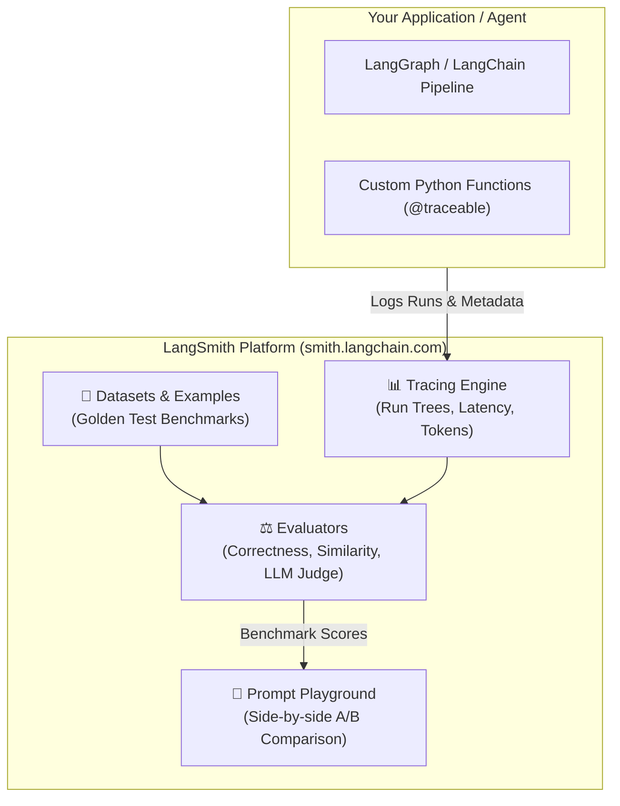

# Week 24: LangSmith 

---

## 🧭 Overview of Week 24 Curriculum

| Topic | Core Focus | What Students Learn |
| :--- | :--- | :--- |
| **1. Tracing** | Observability & Call Trees | Automatically logging full input/output trees, latency, token costs, and sub-steps for every chain, agent, or custom function. |
| **2. Monitoring** | Production Health & Metrics | Tracking token spend, p50/p95/p99 latency, failure rates, and attaching user feedback scores (thumbs up/down). |
| **3. Evaluation** | LLM-as-a-Judge & Heuristics | Programmatically scoring model answers using rule-based checks (regex, length) and LLM judges (correctness, relevance). |
| **4. Debugging** | Root-Cause Analysis | Pinpointing exactly where multi-step agents fail, inspecting token blowups, and replaying runs in the LangSmith Playground. |
| **5. Dataset Testing** | CI/CD for AI & Test Suites | Creating golden evaluation datasets (inputs + expected outputs) and running automated regression test suites. |
| **6. Prompt Comparison** | A/B Testing & Optimization | Benchmarking Prompt Version A vs Prompt Version B against the same dataset to pick the most accurate and cost-effective prompt. |

---

## 🗺️ The LangSmith Architecture



---

## 🔑 1. Setup & Tracing (Zero-Code-Change Observability)

### How It Works:
LangSmith integrates natively with LangChain and LangGraph. You don't need to wrap every line of code in logging statements. Just set 3 environment variables:

```bash
# In your .env file
LANGCHAIN_TRACING_V2=true
LANGCHAIN_API_KEY=lsv2_pt_your_langsmith_api_key_here
LANGCHAIN_PROJECT=Week-24-LangSmith
LANGCHAIN_ENDPOINT=https://api.smith.langchain.com
```

### The `@traceable` Decorator for Pure Python:
If you have custom functions that do not use LangChain (e.g., regex cleaning, database fetching, or custom scoring), you trace them with a single line:

```python
from langsmith import traceable

@traceable(name="clean_raw_text", run_type="parser")
def clean_text(raw_input: str) -> str:
    return raw_input.strip().lower()
```

---

## 📈 2. Monitoring in Production

In the LangSmith dashboard (`https://smith.langchain.com`):
1. **Projects:** Each environment (e.g., `dev`, `staging`, `production`) gets its own Project.
2. **Run Metrics:**
   - **Latency:** Drill down into which specific tool call or model invocation took 80% of the execution time.
   - **Token Count & Cost:** Monitor cumulative prompt and completion tokens.
   - **Feedback Collection:** Attach user sentiment directly to a trace:
     ```python
     from langsmith import Client
     client = Client()
     client.create_feedback(
         run_id="run-uuid-here",
         key="user_score",
         score=1.0, # 1 for thumbs up, 0 for thumbs down
         comment="Customer found the answer very helpful"
     )
     ```

---

## ⚖️ 3. Evaluation (Automated Quality Assurance)

Manual spot-checking doesn't scale. LangSmith evaluation uses **Evaluators** to score runs:
1. **Rule-Based Evaluators:**
   - Did the output contain required keywords?
   - Is it valid JSON?
   - Did it finish within 2 seconds?
2. **LLM-as-a-Judge Evaluators:**
   - A secondary LLM (e.g., `gpt-4o-mini`) inspects the student's or agent's answer against an expected answer and grades correctness from 1 to 5 with reasoning.

---

## 🐞 4. Debugging & The Playground

When an agent hallucinates or crashes:
1. Open the failed run in LangSmith.
2. Inspect the **Run Tree**: Click on the exact step that produced the bad output.
3. Click **"Open in Playground"**:
   - LangSmith opens the exact prompt, model parameters, and context in an interactive UI.
   - You can tweak the temperature, adjust the system prompt, and hit "Run" in your browser without restarting your local Python server!

---

## 📁 5. Dataset Testing (Golden Benchmarks)

Instead of testing your agent with one random prompt at a time:
1. Create a **Dataset** in LangSmith containing 10–50 representative input/output pairs:
   - Example Input: `"What is the refund policy for annual enterprise plans?"`
   - Expected Output: `"Full refund within 30 days of purchase under Section 3.1."`
2. Run your pipeline through the test suite:
   ```python
   from langsmith.evaluation import evaluate

   results = evaluate(
       target=my_agent_pipeline,
       data="Enterprise Support Golden Dataset",
       evaluators=[exact_match_evaluator, llm_judge_evaluator],
       experiment_prefix="v1-prompt-test"
   )
   ```

---

## 🆚 6. Prompt Comparison (A/B Testing)

How do you prove that Prompt V2 is better than Prompt V1?
1. Run **Prompt V1** across your evaluation dataset $\to$ Observe 78% accuracy, 450 tokens/query.
2. Run **Prompt V2** across the same dataset $\to$ Observe 92% accuracy, 310 tokens/query.
3. LangSmith displays a **Side-by-Side Diff Table** highlighting exactly which test cases improved, regressed, or stayed the same!

---

## 💻 Included Practical Lab Files in Workspace

1. **[15_langsmith_tracing.py](file:///e:/python-DS1000/langgraph/15_langsmith_tracing.py)**:
   - Hands-on guide to enabling automatic tracing, using `@traceable`, tags, and metadata.
2. **[16_langsmith_evaluation_datasets.py](file:///e:/python-DS1000/langgraph/16_langsmith_evaluation_datasets.py)**:
   - Programmatically creating evaluation datasets, writing custom evaluators, and running automated test suites.
3. **[17_langsmith_prompt_comparison.py](file:///e:/python-DS1000/langgraph/17_langsmith_prompt_comparison.py)**:
   - Running Prompt A vs Prompt B against the benchmark dataset and comparing accuracy and latency.
