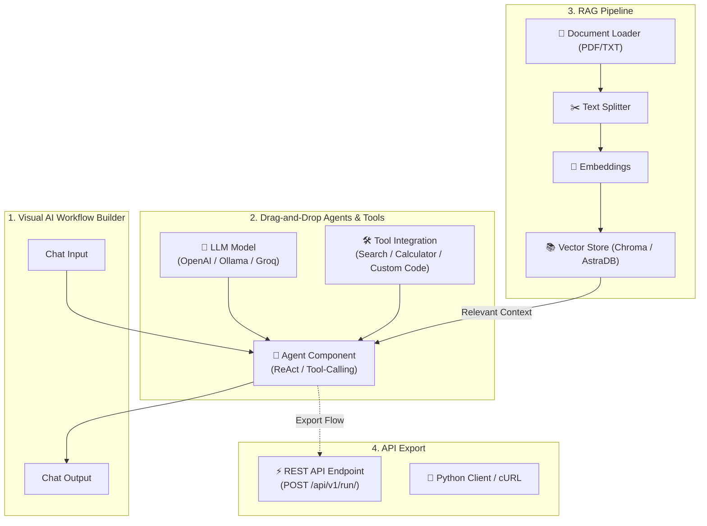

# Week 25: LangFlow - Master Curriculum & Practical Guide

---

## 🧭 What is LangFlow?

**LangFlow** is an open-source, visual drag-and-drop web UI specifically designed for building, prototyping, and deploying **LangChain & AI Agent pipelines**.

### 🥊 Comparison: Where does LangFlow fit?

| Platform | Primary Purpose | How it Works |
| :--- | :--- | :--- |
| **LangChain / LangGraph** | Code-first Framework | Python / TypeScript code for stateful multi-agent graphs. |
| **n8n** | General Workflow Automation | Connects web APIs (Gmail, Sheets, Slack, Stripe) with AI nodes. |
| **LangFlow** | Visual AI Architecture Studio | Dedicated visual canvas specifically for RAG, Vector Databases, Embeddings, Prompts, and Agent Tools. |

---

## 🗺️ The 5 Core Topics Breakdown



---

## 🚀 1. Visual AI Workflow Builder

### How to Install and Run LangFlow
LangFlow runs locally on your machine via Python:

```bash
# 1. Install LangFlow
pip install langflow

# 2. Start the local server
python -m langflow run
```
LangFlow will launch your browser at:  
👉 **`http://127.0.0.1:7860`**

### Canvas Navigation Anatomy:
1. **Left Sidebar (Components):**
   - **Inputs / Outputs:** `Chat Input`, `Chat Output`, `Text Input`.
   - **Models:** `OpenAI`, `Ollama`, `Groq`, `Anthropic`, `HuggingFace`.
   - **Prompts:** `Prompt Template` with dynamic `{variable}` placeholders.
   - **Vector Stores:** `Chroma`, `AstraDB`, `FAISS`, `Pinecone`.
   - **Agents & Tools:** `Agent`, `Calculator`, `DuckDuckGo Search`, `Python Code Tool`.
2. **Main Canvas:** Drag nodes, wire output sockets to compatible input sockets.
3. **Playground (Bottom-Right Chat Bubble):** Test the entire pipeline in an interactive chat interface without writing any frontend code!

---

## 🤖 2. Drag-and-Drop Agents

In LangFlow, an Agent is an autonomous reasoning engine that decides **which tools to call** and **how to answer the user**.

### How to Build an Agent on the Canvas:
1. Drag an **`Agent`** component onto the canvas.
2. Drag an **`OpenAI`** (or **`Ollama`**) model component.
   - Connect the model's output to the Agent's **Language Model** input port.
3. Drag a **`Chat Memory`** component.
   - Connect it to the Agent's **Memory** input port (retains multi-turn conversation history).
4. Connect **`Chat Input`** $\to$ Agent $\to$ **`Chat Output`**.
5. Click the **Playground** button: Your agent is alive and conversing!

---

## 📚 3. RAG Pipelines (Retrieval-Augmented Generation)

RAG allows an AI to read private company files (PDFs, Word docs, spreadsheets) and answer questions with factual accuracy.

### The 5-Step Visual RAG Pipeline:

1. **`File` Component:** Upload your PDF, policy manual, or text file.
2. **`Recursive Character Text Splitter`:** Splits large documents into manageable chunks (e.g., chunk size = 1000, overlap = 200).
3. **`Embeddings` (e.g. OpenAI / Ollama):** Converts text chunks into mathematical vectors.
4. **`Vector Store` (e.g. Chroma / AstraDB / In-Memory):** Stores document vectors and performs semantic similarity search.
5. **`Parse Data` $\to$ `Prompt`:** Injects the retrieved chunks into a prompt:
   ```text
   Context from documents:
   {context}

   User Question: {question}
   Answer accurately based only on the context above.
   ```

---

## 🛠️ 4. Tool Integration

Agents can use external tools to perform actions they cannot do alone:

### A. Built-in Tools
* **`Calculator`:** Enables exact math calculations without model hallucination.
* **`Search Tool` (DuckDuckGo / Tavily):** Fetches real-time live internet information.
* **`Python Code Tool`:** Runs sandboxed Python code to process data or create graphs.

### B. Custom Python Tools (Direct in the Browser)
In LangFlow, you can create a custom tool with standard Python:
```python
from langflow.custom import Component
from langflow.field_typing import Tool

class CurrencyConverterTool(Component):
    display_name = "Currency Converter"
    description = "Converts USD to EUR or INR"

    def build_tool(self) -> Tool:
        def convert(amount: float, target_currency: str) -> str:
            rates = {"EUR": 0.92, "INR": 83.5}
            rate = rates.get(target_currency.upper(), 1.0)
            return f"{amount} USD = {amount * rate} {target_currency.upper()}"
        
        return Tool(name="currency_converter", func=convert, description="Convert currencies")
```
Just wire this component into the Agent's **Tools** port!

---

## ⚡ 5. API Export (Production Deployment)

Once your visual workflow is perfected, you can turn it into an API endpoint that can be called from React, Flutter, Python, or n8n!

### Step 1: Open the API Modal
Click the **`API`** button in the top-right corner of the LangFlow canvas.

### Step 2: Choose Your Language
LangFlow automatically generates copy-paste ready code in:
* **cURL** (for terminal or Postman)
* **Python** (using `requests` or `langflow` client)
* **JavaScript / TypeScript** (for frontend apps)

### Simple Python API Call:
```python
import requests

# LangFlow local API endpoint
API_URL = "http://127.0.0.1:7860/api/v1/run/<YOUR_FLOW_ID>"

payload = {
    "input_value": "What is our company refund policy?",
    "output_type": "chat",
    "input_type": "chat"
}

response = requests.post(API_URL, json=payload)
result = response.json()
print("AI Response:", result["outputs"][0]["outputs"][0]["results"]["message"]["text"])
```

---

## 🎯 How to Teach This Week (Classroom Walkthrough)

1. **The Hook (5 min):** *"We previously wrote agents in Python (LangGraph) and workflows in n8n. Today, we will build complex RAG and multi-tool agents purely visually using LangFlow, test them in a built-in chat UI, and export them as production REST APIs in 1 click."*
2. **Live Build 1 (15 min):** Launch `langflow run`. Drag `Chat Input` $\to$ `Prompt` $\to$ `OpenAI Model` $\to$ `Chat Output`. Test in the Playground.
3. **Live Build 2 (20 min):** Add the `Agent` component and attach the `Calculator` and `Web Search` tools. Ask the agent: *"What is the square root of 9832 multiplied by today's stock price of Apple?"* Show how the agent autonomously calls both tools.
4. **Live Build 3 (20 min):** Drag in a PDF of a company policy, hook up `Chroma Vector Store`, and query it.
5. **Production Export (10 min):** Click the **API** button, copy the Python script, run it in VS Code, and show the terminal receiving the visual flow's output!

