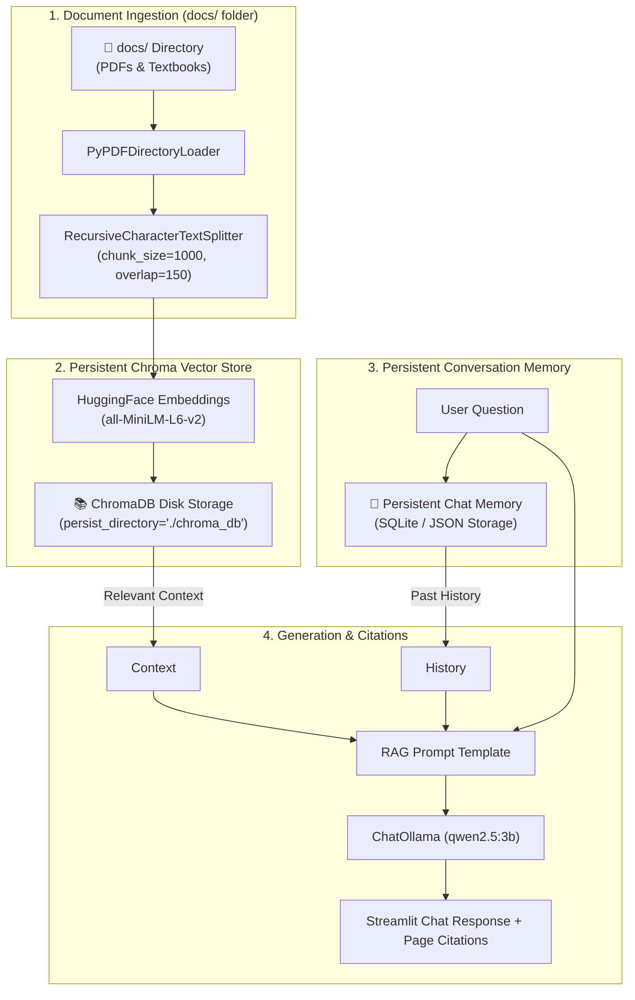

# Student Project Review & Upgrade Guide: PDF RAG Chatbot

---

## 🔍 1. Executive Analysis of `app.py`

### What the Student Did Well:
- **Clean UI & Experience:** Good use of Streamlit chat elements (`st.chat_message`, `st.chat_input`, `st.expander` for citations).
- **Page Metadata:** Extracts and displays page number citations (`[Page X]`).
- **Topic Categorization:** Includes a custom `detect_topic` function to categorize inquiries in the sidebar.
- **Defensive Error Handling:** Checks for zero-page PDFs and empty text before embedding.

---

### What is Missing / Needs Upgrading:

| Required Feature | Current Implementation in `app.py` | Why It Needs to Be Upgraded |
| :--- | :--- | :--- |
| **1. Dedicated `docs/` Directory** | Files are uploaded one-by-one into a transient `tempfile.NamedTemporaryFile` and deleted immediately. | If the app restarts or another user opens it, the PDF is lost. A dedicated `docs/` folder allows persistent, automatic ingestion of all course materials. |
| **2. Chroma Vector Store** | Uses **`FAISS` in RAM** (`st.session_state.vectorstore = FAISS.from_documents(...)`). | In-memory FAISS loses all embeddings on every page refresh or server restart. It must be re-embedded (wasting CPU & time). Chroma saves embeddings to disk (`./chroma_db`). |
| **3. Conversational Memory** | Rudimentary manual string loop (`for msg in messages: history_text += ...`) stored in ephemeral Streamlit RAM. | Fails on refresh, doesn't prune long contexts (risking token overflow), and lacks persistent storage (SQLite or JSON). |
| **4. Verbose Terminal Logging** | Almost zero terminal output (`print` statements). When running `streamlit run app.py`, the terminal is completely silent. | Instructors and students cannot debug latency, see chunk sizes, or inspect prompt inputs and retrieved documents. |

---

## 🏗️ 2. Step-by-Step Architecture Upgrade Plan



---

## 🛠️ 3. How to Implement Each Missing Feature

### Phase 1: Setting up the `docs/` Folder
Instead of forcing users to upload files via the web UI every single time, create a `docs/` folder:
1. Create directory `docs/`.
2. Add PDF documents (e.g. `python_handbook.pdf`, `syllabus.pdf`).
3. Replace the single-file loader with `PyPDFDirectoryLoader`:
   ```python
   from langchain_community.document_loaders import PyPDFDirectoryLoader

   # Ingests all PDFs automatically from the docs folder
   loader = PyPDFDirectoryLoader("docs/")
   documents = loader.load()
   ```

---

### Phase 2: Upgrading from FAISS to Persistent Chroma

#### Why Chroma?
- FAISS in RAM vanishes when the process stops.
- Chroma persists vectors to disk in a local directory (`./chroma_db`).
- Once embedded, startup is **instant**—no re-calculating embeddings!

#### Installation:
```bash
pip install langchain-chroma chromadb
```

#### Code Implementation:
```python
import os
from langchain_chroma import Chroma
from langchain_huggingface import HuggingFaceEmbeddings

CHROMA_PATH = "./chroma_db"
embeddings = HuggingFaceEmbeddings(model_name="sentence-transformers/all-MiniLM-L6-v2")

# Check if vector store already exists on disk
if os.path.exists(CHROMA_PATH):
    # Load existing persistent database (Zero re-embedding latency!)
    vectorstore = Chroma(
        persist_directory=CHROMA_PATH,
        embedding_function=embeddings
    )
else:
    # First time only: create and persist
    vectorstore = Chroma.from_documents(
        documents=chunks,
        embedding=embeddings,
        persist_directory=CHROMA_PATH
    )
```

---

### Phase 3: True Memory Feature & Persistent Storage

#### Current limitation in `app.py`:
The student wrote:
```python
# In app.py lines 349-356:
history_text = ""
for msg in messages:
    history_text += f"{msg['role']}: {msg['content']}\n"
```
This causes token overflow on long chats and is wiped whenever the browser tab refreshes.

#### The Professional Upgrade:
Use **`ConversationBufferWindowMemory`** or **`SQLChatMessageHistory`**:

```python
from langchain_community.chat_message_histories import SQLChatMessageHistory

# Connects chat history to a lightweight local SQLite database
def get_session_history(session_id: str):
    return SQLChatMessageHistory(
        session_id=session_id,
        connection_string="sqlite:///chat_history.db"
    )
```
- **Survives restarts:** Even if Streamlit or the browser crashes, the conversation history is restored from `chat_history.db`.
- **Sliding Window:** Automatically discards older messages to protect token limits.

---

## 💻 4. Complete Future Blueprint (What the Refactored `app.py` Should Look Like)

*(Share this with the student as the reference implementation once they are ready to upgrade):*

```python
import os
import streamlit as st
from langchain_community.document_loaders import PyPDFDirectoryLoader
from langchain_text_splitters import RecursiveCharacterTextSplitter
from langchain_huggingface import HuggingFaceEmbeddings
from langchain_chroma import Chroma
from langchain_ollama import ChatOllama
from langchain_community.chat_message_histories import SQLChatMessageHistory

# 1. Setup paths
DOCS_DIR = "docs"
CHROMA_DIR = "./chroma_db"
os.makedirs(DOCS_DIR, exist_ok=True)

st.set_page_config(page_title="Chroma RAG Assistant", page_icon="🤖")
st.title("📚 Persistent Chroma RAG & Memory Assistant")

# 2. Initialize Embeddings & Chroma Vector Store
embeddings = HuggingFaceEmbeddings(model_name="sentence-transformers/all-MiniLM-L6-v2")

@st.cache_resource
def load_or_create_vectorstore():
    if os.path.exists(CHROMA_DIR) and len(os.listdir(CHROMA_DIR)) > 0:
        print("[VECTORSTORE] Loading existing Chroma database from disk...")
        return Chroma(persist_directory=CHROMA_DIR, embedding_function=embeddings)
    else:
        print("[VECTORSTORE] Ingesting documents from 'docs/' directory...")
        loader = PyPDFDirectoryLoader(DOCS_DIR)
        docs = loader.load()
        if not docs:
            return None
        splitter = RecursiveCharacterTextSplitter(chunk_size=1000, chunk_overlap=150)
        chunks = splitter.split_documents(docs)
        return Chroma.from_documents(chunks, embeddings, persist_directory=CHROMA_DIR)

vectorstore = load_or_create_vectorstore()

# 3. Persistent Memory via SQLite
chat_history = SQLChatMessageHistory(
    session_id="student_session_1",
    connection_string="sqlite:///chat_history.db"
)

# Render existing chat history
for msg in chat_history.messages:
    with st.chat_message(msg.type):
        st.markdown(msg.content)

# 4. Chat Input & Retrieval
question = st.chat_input("Ask a question about the documents:")
if question:
    with st.chat_message("user"):
        st.markdown(question)
    chat_history.add_user_message(question)

    if vectorstore is None:
        st.warning("Please add PDF files to the 'docs/' directory.")
    else:
        with st.chat_message("assistant"):
            # Retrieve top k=2 relevant chunks
            docs = vectorstore.similarity_search(question, k=2)
            context = "\n\n".join([f"[Page {d.metadata.get('page', 0)+1}]\n{d.page_content}" for d in docs])
            
            # Formulate RAG Prompt with memory
            history_text = "\n".join([f"{m.type}: {m.content}" for m in chat_history.messages[-5:]])
            prompt = f"Context:\n{context}\n\nHistory:\n{history_text}\n\nQuestion: {question}\n\nAnswer:"
            
            llm = ChatOllama(model="qwen2.5:3b", temperature=0)
            response = llm.invoke(prompt).content
            st.markdown(response)
            chat_history.add_ai_message(response)
```

