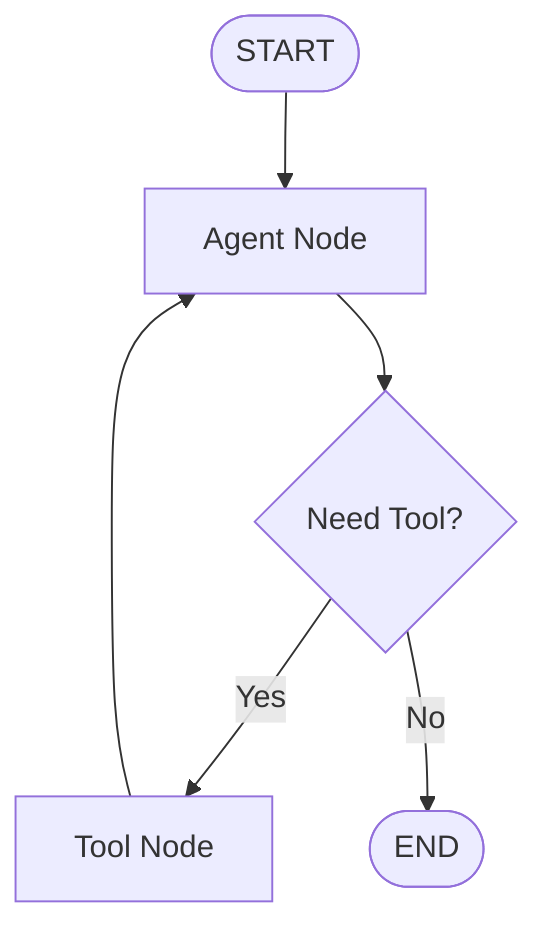
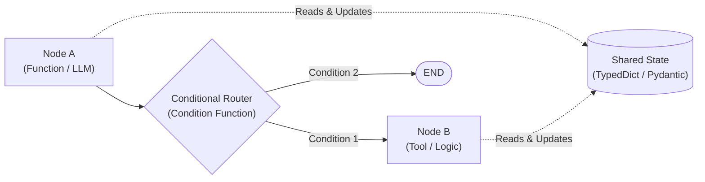

# Introduction to LangGraph

LangGraph is an open-source framework developed by LangChain for building complex, controllable, stateful, and multi-agent AI applications with large language models (LLMs).

Unlike standard linear pipelines or Directed Acyclic Graphs (DAGs), LangGraph allows you to build **cyclic graphs**, enabling agentic workflows that require loops, self-correction, tool execution cycles, human-in-the-loop approvals, and persistent state.

---

## Table of Contents

1. [What is LangGraph & What is it Used For?](#what-is-langgraph--what-is-it-used-for)
2. [Why LangGraph?](#why-langgraph)
3. [Core Architecture & Key Concepts](#core-architecture--key-concepts)
   - [1. State](#1-state)
   - [2. Nodes](#2-nodes)
   - [3. Edges](#3-edges)
   - [4. Conditional Routing (Conditional Edges)](#4-conditional-routing-conditional-edges)
   - [5. START and END Sentinels](#5-start-and-end-sentinels)
   - [6. Checkpointers & Persistence](#6-checkpointers--persistence)
4. [Installation](#installation)
5. [Hands-On Quickstart](#hands-on-quickstart)
   - [Example 1: Minimal Hello World Graph](#example-1-minimal-hello-world-graph)
   - [Example 2: Tool-Calling Agent with Conditional Edges](#example-2-tool-calling-agent-with-conditional-edges)
   - [Example 3: Persistent Memory & Sessions](#example-3-persistent-memory-and-sessions)
   - [Example 4: Human-in-the-Loop (Approval / Interruption)](#example-4-human-in-the-loop-approval--interruption)
6. [LangGraph vs. Standard LangChain](#langgraph-vs-standard-langchain)
7. [Best Practices](#best-practices)

---

## What is LangGraph & What is it Used For?

**LangGraph** is a library for building stateful, multi-actor, cyclic applications with LLMs. While traditional LLM frameworks focus on step-by-step linear chains (DAGs), LangGraph is designed specifically for **agentic architectures** that need control flow, loops, state persistence, and branching.

### Primary Use Cases

1. **Autonomous Tool-Calling Agents (ReAct Loop)**:
   - Agents that plan actions, invoke tools (search, APIs, databases), inspect outputs, and iteratively loop until a complete answer is formed.
2. **Multi-Agent Collaboration & Supervision**:
   - Systems composed of specialized agents (e.g., a "Researcher", "Writer", and "Editor") coordinated either via a supervisor agent, router, or decentralized peer-to-peer handoffs.
3. **Self-Correction & Reflection Workflows**:
   - Code generation, document drafting, or SQL query generation where an LLM generates code, a node executes/tests it, and if errors occur, routes back to the LLM to self-correct.
4. **Human-in-the-Loop (HITL) Workflows**:
   - Workflows requiring approval or human input prior to executing sensitive actions (e.g., sending emails, modifying production databases, financial transfers).
5. **Long-Running & Stateful Chatbots**:
   - Conversational bots that maintain session histories across days or weeks with thread-level persistence, memory rewind ("time-travel"), and state inspection.
6. **Complex Business Logic & Deterministic Fallbacks**:
   - Combining unpredictable LLM reasoning with deterministic procedural logic, fallback routes, validation guards, and compliance checks.

---

## Why LangGraph?

Traditional LLM chains flow in one direction:

```
Prompt -> LLM -> Output Parser
```

However, real-world agentic workflows require:
- **Loops & Retries**: Agents deciding to query tools, review results, and retry if output is insufficient.
- **State Persistence**: Preserving conversation history, multi-turn tool outputs, and variable updates.
- **Human-in-the-loop**: Pausing execution to ask a human for confirmation, input, or edits before continuing.
- **Multi-Agent Coordination**: Routing between specialized agents.

LangGraph models these behaviors as a graph where **nodes** perform work and **edges** determine control flow.



---

## Core Architecture & Key Concepts

LangGraph is built on four core foundational primitives: **State**, **Nodes**, **Edges**, and **Conditional Routing**.



---

### 1. State

**State** is the central data store of your graph. It represents the shared memory and context passed between every node.

- **Schema Definition**: You define state using Python's `TypedDict` or Pydantic `BaseModel`.
- **Node Input & Output**: Every node receives the current state as its argument and returns a dictionary with updates to one or more keys.
- **Reducers (Accumulators)**: By default, returning a key overwrites its previous value. To append or merge values instead (e.g., chat message history), you annotate keys with **reducers** like `add_messages` or `operator.add`.

```python
from typing import TypedDict, Annotated
import operator
from langgraph.graph.message import add_messages

class AgentState(TypedDict):
    # `add_messages` automatically appends new messages and updates existing ones by ID
    messages: Annotated[list, add_messages]
    # `operator.add` appends items to a list rather than overwriting
    search_queries: Annotated[list[str], operator.add]
    # Standard key: updated by overwriting
    retry_count: int
    current_step: str
```

---

### 2. Nodes

**Nodes** are the units of work in the graph. They represent discrete steps or actions performed during execution.

- A node is simply a Python function (or runnable) that takes the current `state` (and optional `config`) as input and returns a dictionary updating state keys.
- Nodes can execute LLM calls, tool executions, API requests, database queries, or data transformations.

```python
def call_model_node(state: AgentState) -> dict:
    """Invokes LLM with current messages and increments step count."""
    messages = state["messages"]
    response = model.invoke(messages)
    return {
        "messages": [response],
        "current_step": "model_called"
    }

def execute_tool_node(state: AgentState) -> dict:
    """Executes a specific tool action based on state."""
    # Run tool logic...
    return {"current_step": "tool_executed"}
```

Adding nodes to your graph builder:
```python
builder.add_node("call_model", call_model_node)
builder.add_node("execute_tool", execute_tool_node)
```

---

### 3. Edges

**Edges** define the flow of execution from one node to the next.

- **Static / Normal Edges**: Deterministic transitions where completing Node A *always* transitions directly to Node B.
- Created using `builder.add_edge("source_node", "target_node")`.

```python
# Always transition from START -> call_model
builder.add_edge(START, "call_model")

# Always transition from execute_tool -> call_model (creating a loop)
builder.add_edge("execute_tool", "call_model")
```

---

### 4. Conditional Routing (Conditional Edges)

**Conditional Routing** allows dynamic decision making and non-deterministic control flow. Instead of fixed transitions, an edge evaluates a **routing function** that inspects the current state and decides which node to execute next.

#### How Conditional Routing Works:
1. **Source Node**: Where the branch originates.
2. **Routing Function (Condition)**: A callable that inspects `state` and returns a string (decision key).
3. **Path Map (Optional but recommended)**: A dictionary mapping returned string keys to target node names or `END`.

#### Pattern A: Built-in `tools_condition` (Agent Tool Calling)
LangGraph provides prebuilt routing for tool calls:
```python
from langgraph.prebuilt import tools_condition

# Routes to "tools" if the model generated tool calls, otherwise routes to END
builder.add_conditional_edges(
    "call_model",
    tools_condition,
    {
        "tools": "execute_tool",
        "__end__": END
    }
)
```

#### Pattern B: Custom Conditional Routing Function
You can write custom conditional functions for classification, validation, error handling, or quality evaluation:

```python
from typing import Literal

def route_evaluator(state: AgentState) -> Literal["retry", "human_review", "finalize"]:
    """Inspects state to determine the next step."""
    if state.get("retry_count", 0) > 3:
        return "human_review"
    elif "ERROR" in state["messages"][-1].content:
        return "retry"
    else:
        return "finalize"

builder.add_conditional_edges(
    "evaluator_node",
    route_evaluator,
    {
        "retry": "call_model",
        "human_review": "human_node",
        "finalize": END
    }
)
```

---

### 5. START and END Sentinels

- `START`: The initial entry point into the graph. Every graph must define an edge from `START` to its initial node (`builder.add_edge(START, "first_node")`).
- `END`: The terminal sentinel. Routing to `END` stops graph execution and yields the final state to the caller.

---

### 6. Checkpointers & Persistence

Checkpointers save state snapshots at every step (superstep) into durable storage (MemorySaver, SQLite, Postgres, Redis).
This enables:
- **Session Memory**: Continue conversations by scoping executions with `thread_id`.
- **Time-Travel & Debugging**: Rewind graph execution back to any past state checkpoint.
- **Human-in-the-Loop Interruptions**: Safely suspend graph execution waiting for external user inputs or approvals.

---

## Installation

Install LangGraph and core dependencies using pip:

```bash
pip install -U langgraph langchain-core langchain-openai
```

Set your OpenAI or preferred model API key:

```bash
# On Linux / macOS
export OPENAI_API_KEY="your-api-key"

# On Windows PowerShell
$env:OPENAI_API_KEY="your-api-key"
```

---

## Hands-On Quickstart

### Example 1: Minimal Hello World Graph

A simple 2-node graph to demonstrate state flow.

```python
from typing import TypedDict
from langgraph.graph import StateGraph, START, END

# 1. Define the State
class SimpleState(TypedDict):
    message: str

# 2. Define Node Functions
def greeting_node(state: SimpleState) -> dict:
    return {"message": state["message"] + " -> Hello from Node 1"}

def farewell_node(state: SimpleState) -> dict:
    return {"message": state["message"] + " -> Goodbye from Node 2"}

# 3. Build the Graph
builder = StateGraph(SimpleState)

builder.add_node("greeting", greeting_node)
builder.add_node("farewell", farewell_node)

builder.add_edge(START, "greeting")
builder.add_edge("greeting", "farewell")
builder.add_edge("farewell", END)

# 4. Compile the Graph
graph = builder.compile()

# 5. Invoke
result = graph.invoke({"message": "Start"})
print(result["message"])
# Output: Start -> Hello from Node 1 -> Goodbye from Node 2
```

---

### Example 2: Tool-Calling Agent with Conditional Edges

This pattern forms the basis of autonomous agents (ReAct pattern).

```python
from typing import Annotated
from typing_extensions import TypedDict
from langchain_openai import ChatOpenAI
from langchain_core.messages import HumanMessage
from langchain_core.tools import tool
from langgraph.graph import StateGraph, START, END
from langgraph.graph.message import add_messages
from langgraph.prebuilt import ToolNode, tools_condition

# 1. Define a tool
@tool
def get_weather(city: str) -> str:
    """Get the current weather for a city."""
    return f"The weather in {city} is sunny and 22°C."

tools = [get_weather]
model = ChatOpenAI(model="gpt-4o-mini").bind_tools(tools)

# 2. Define Graph State
class AgentState(TypedDict):
    messages: Annotated[list, add_messages]

# 3. Define the LLM Node
def agent_node(state: AgentState):
    response = model.invoke(state["messages"])
    return {"messages": [response]}

# 4. Assemble Graph
builder = StateGraph(AgentState)

builder.add_node("agent", agent_node)
builder.add_node("tools", ToolNode(tools))

builder.add_edge(START, "agent")

# If the agent decided to call tools, route to 'tools', otherwise route to END
builder.add_conditional_edges(
    "agent",
    tools_condition,
)

# After tool execution, loop back to the agent to synthesize final response
builder.add_edge("tools", "agent")

graph = builder.compile()

# 5. Run the Agent
response = graph.invoke({
    "messages": [HumanMessage(content="What's the weather like in Tokyo?")]
})

for msg in response["messages"]:
    print(f"[{msg.type}]: {msg.content}")
```

---

### Example 3: Persistent Memory and Sessions

Use `MemorySaver` to retain conversational memory across turns by tracking threads.

```python
from langgraph.checkpoint.memory import MemorySaver

memory = MemorySaver()
graph = builder.compile(checkpointer=memory)

# Define thread configuration
config = {"configurable": {"thread_id": "session-user-123"}}

# Turn 1
r1 = graph.invoke(
    {"messages": [HumanMessage(content="Hi, my name is Alex!")]},
    config=config
)

# Turn 2 (agent remembers context via thread_id)
r2 = graph.invoke(
    {"messages": [HumanMessage(content="What is my name?")]},
    config=config
)

print(r2["messages"][-1].content)
# Output: "Your name is Alex!"
```

---

### Example 4: Human-in-the-Loop (Approval / Interruption)

You can pause the graph before dangerous tool calls (e.g., sending emails, running SQL queries, executing code).

```python
# Pause execution before executing the 'tools' node
graph = builder.compile(
    checkpointer=memory,
    interrupt_before=["tools"]
)

config = {"configurable": {"thread_id": "approval-thread-1"}}

# 1. Start execution (will stop before 'tools')
graph.invoke(
    {"messages": [HumanMessage(content="Delete database records for user 42")]},
    config=config
)

# 2. Inspect state
current_state = graph.get_state(config)
print("Next pending action:", current_state.next)  # ('tools',)

# 3. Resume after human approval (passing None resumes from current checkpoint)
graph.invoke(None, config=config)
```

---

## LangGraph vs. Standard LangChain

| Feature | LangChain Expression Language (LCEL) | LangGraph |
|---|---|---|
| **Graph Structure** | Strictly Directed Acyclic Graph (DAG) | Cyclic Graphs (loops supported) |
| **State Management** | Ephemeral, stateless per invoke | Built-in state schemas with reducers |
| **Persistence** | Relies on external memory classes | Native checkpointers (`thread_id`, snapshots) |
| **Human-in-the-Loop** | Difficult to pause/resume mid-chain | First-class (`interrupt_before`, `interrupt_after`) |
| **Multi-Agent Systems**| Limited coordination primitives | Flexible subgraphs and hierarchical agents |

---

## Best Practices

1. **Always specify reducers for lists**: When accumulating messages or logs, use `Annotated[list, add_messages]` or `Annotated[list, operator.add]` to avoid accidental overwrites.
2. **Use `tools_condition`**: For standard tool calling, rely on `langgraph.prebuilt.tools_condition` rather than writing custom routing boilerplate.
3. **Use unique `thread_id` values**: Tie thread IDs to user sessions or workflow runs to prevent state collision.
4. **Visualize your graph**: You can inspect your graph visually using Mermaid:
   ```python
   print(graph.get_graph().draw_mermaid())
   ```
   Or export to PNG:
   ```python
   display(Image(graph.get_graph().draw_mermaid_png()))
   ```
5. **Decouple business logic**: Keep individual node functions small, testable, and focused on updating state rather than orchestrating global control flow.
