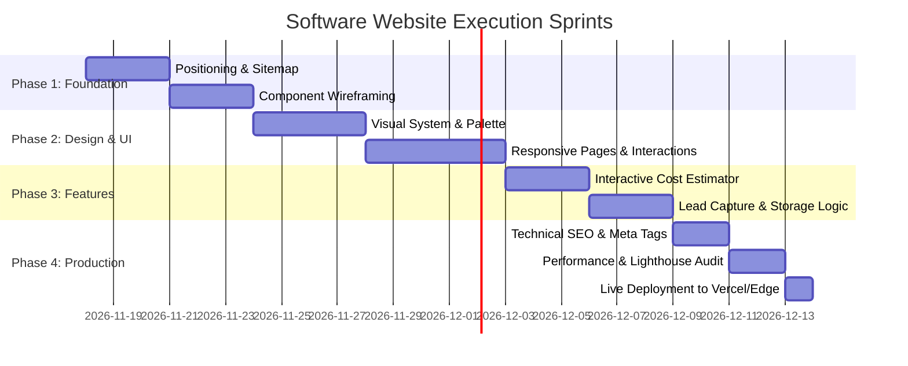

# Software Company Website: Comprehensive Architecture & Phased Task Plan

---

## 🧭 Project Overview: NexusLogic Systems

This folder (`e:\python-DS1000\langgraph\sample project`) contains the complete website codebase, modular design, and technical task execution plan for a high-performance software and AI systems company.

### Included Website Structure:
- 📄 **`index.html`**: Homepage with Hero, Trust Metrics, 3 Pillar Capabilities, Interactive Tech Stack filter, and an **Interactive Project Cost & Timeline Calculator**.
- 📄 **`services.html`**: Engineering Services deep-dive with code architecture examples.
- 📄 **`case-studies.html`**: Production metrics and results-driven client showcases.
- 📄 **`contact.html`**: High-intent discovery booking form with client-side validation and local storage lead capture.
- 🎨 **`css/style.css`**: Glassmorphism, custom scrollbars, animations, and ambient glow.
- ⚡ **`js/main.js`**: Interactive dynamic filtering, cost estimator calculator, mobile drawer menu, and lead capture simulation.

---

## 🗺️ Work Breakdown Structure (WBS) & Phased Task Plan



---

### Sprint 1: Product Positioning & Information Architecture (Days 1–3)
- [x] **Task 1.1: Core Positioning Definition**
  - High-impact value proposition: *"Architecting Scalable Software & Autonomous AI Engines"*.
  - Identified target persona: Enterprise CTOs, VP of Engineering, Technical Founders.
- [x] **Task 1.2: Sitemap & Navigation Hierarchy**
  - Primary Pages: `Home`, `Services`, `Case Studies`, `Contact`.
  - Secondary Anchors: `#tech-stack`, `#estimator`.
- [x] **Task 1.3: Wireframing & Responsive Layout Specification**
  - Designed for mobile, tablet, and desktop viewports.

---

### Sprint 2: Frontend Engineering & Visual System (Days 4–8)
- [x] **Task 2.1: Design Tokens & Styling**
  - Dark-mode glassmorphic theme using Tailwind CSS slate-950 foundation.
  - Accent color accents: Indigo (`#6366f1`), Cyan (`#06b6d4`), Emerald (`#10b981`).
- [x] **Task 2.2: Homepage Construction (`index.html`)**
  - Sticky glassmorphic navbar with mobile slide-out drawer.
  - Social proof metrics strip (99.99% Uptime, 120+ Systems Delivered).
  - 3 Pillar solution cards with hover micro-interactions.
- [x] **Task 2.3: Engineering Services Page (`services.html`)**
  - Visual code snippets showcasing LangGraph agent loops and Kubernetes manifests.
- [x] **Task 2.4: Case Studies Page (`case-studies.html`)**
  - FinTech & Healthcare SaaS ROI statistics (82% ticket automation, $180k cloud savings).

---

### Sprint 3: Interactive Dynamic Features & Lead Capture (Days 9–11)
- [x] **Task 3.1: Interactive Tech Stack Filter**
  - Filter categories: All, AI & ML, Backend & Cloud, Frontend & Mobile, DevOps & Database.
- [x] **Task 3.2: Dynamic Cost & Timeline Estimator Widget**
  - Live calculation based on system type, architecture scale, and technical add-ons.
  - Real-time updates for cost ($) and delivery timeframe (Weeks).
- [x] **Task 3.3: Lead Generation & Discovery Booking Form (`contact.html`)**
  - Multi-attribute form: Name, Email, Company, Service, Budget Tier, Brief.
  - Form validation with simulated submission, toast notifications, and local storage persistence.

---

### Sprint 4: Technical SEO, Accessibility & Deployment (Days 12–14)
- [ ] **Task 4.1: OpenGraph & Social Sharing Cards**
  - Generate 1200x630px social preview images for Twitter/X and LinkedIn.
- [ ] **Task 4.2: Structured Data (JSON-LD)**
  - Embed `Organization` and `ProfessionalService` schema markup.
- [ ] **Task 4.3: Google Lighthouse Audit**
  - Verify 95+ score across Performance, Accessibility, Best Practices, and SEO.
- [ ] **Task 4.4: Deployment to Custom Domain**
  - Deploy via Vercel, Cloudflare Pages, or Netlify with automated SSL and edge caching.

---

## 🚀 How to Run and Preview the Website Right Now

Open your terminal and run a local Python HTTP server inside the folder:

```powershell
cd "e:\python-DS1000\langgraph\sample project"
python -m http.server 3000
```

Then open your browser and navigate to:  
👉 **`http://localhost:3000`**

*(Or simply double-click [index.html](file:///e:/python-DS1000/langgraph/sample%20project/index.html) to open directly in Chrome/Edge!)*
